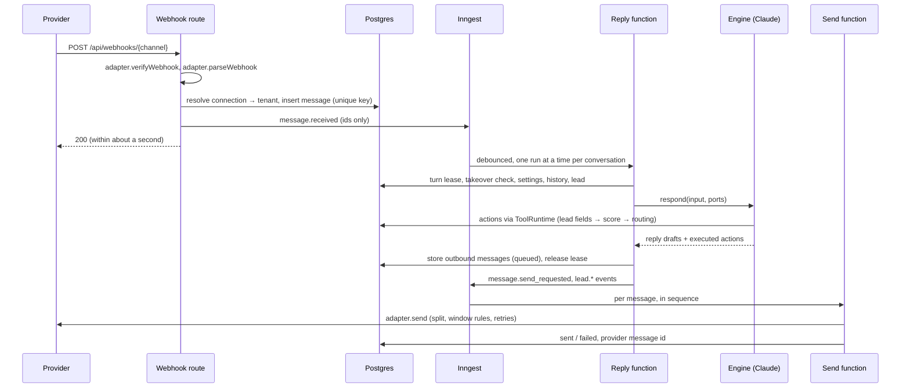

# Architecture

This document is the map every builder reads after `docs/SPEC.md`. It fixes the components,
the path of a message from webhook to reply, the tenancy and security model, the job design,
the folder layout and the contracts between chunks. The contracts also exist as code in
`packages/core/src/contracts` and `packages/core/src/events`; when prose and code disagree,
the code wins and this file gets corrected. Read `docs/BUILD_PLAN.md` next: it says which
paths your chunk owns and how to change the files that several chunks share.

Contents: 1 Components · 2 Inbound webhook to reply · 3 Tenancy and security · 4 Job design ·
5 Claude API rules · 6 Folder layout and package layers · 7 Interfaces between chunks ·
8 Data model · 9 Configuration · 10 Testing · 11 Conventions

## 1. Components

```
 Customers                                                        Agency staff, client users
 WhatsApp · Instagram · Messenger · website widget · email                    │
        │ webhooks / widget API / IMAP poll                                   │ browser
        ▼                                                                     ▼
 ┌────────────────────────────── apps/web (Next.js on Vercel) ──────────────────────────────┐
 │ /api/webhooks/[channel]   /api/widget/v1/*   /api/oauth/*   /api/v1/* (import API)       │
 │ /api/inngest (job endpoint)   /api/health   admin panel and client portal (App Router)   │
 └───────┬───────────────────────────┬───────────────────────────────────────┬─────────────┘
         │ store + emit event        │ run job steps                         │ RLS-scoped reads
         ▼                           ▼                                       ▼
 ┌─ Inngest ─────────────┐   ┌─ packages/* ────────────────────────┐   ┌─ Supabase ──────────┐
 │ durable functions,    │──▶│ pipeline → ai (engine) → Claude API │──▶│ Postgres + RLS      │
 │ debounce, concurrency,│   │ leads · knowledge · scheduling ·    │   │ Auth · Storage ·    │
 │ sleeps, cron, retries │   │ handoff · integrations · channels   │   │ Realtime            │
 └───────────────────────┘   └───────────────┬─────────────────────┘   └─────────────────────┘
                                             ▼
        Meta Graph · Gmail · Microsoft Graph · SMTP/IMAP · Twilio · calendars · Calendly · CRMs
```

| Component | Responsibility | Lives in |
| --- | --- | --- |
| Web app | Every HTTP surface: webhooks, widget API, OAuth callbacks, import API, the Inngest endpoint, the admin panel and the client portal. Thin: routes validate, authorize and call packages. | `apps/web` |
| Message pipeline | Ingest (verify, normalize, store once, emit), the per-conversation reply function, outbound sending, and the composition root that plugs the engine into its ports. | `packages/pipeline` |
| Conversation engine | Builds the prompt, calls Claude, runs the tool loop, returns reply drafts and actions. No side effects of its own. | `packages/ai` |
| Settings engine | Registry of every setting, resolver (default → global → segment → business), versioned and audited store. | `packages/settings` |
| Knowledge and playbooks | Business facts (import, crawl, retrieval) and per-segment industry playbooks (generation, versions, overrides). | `packages/knowledge` |
| Leads | Per-criterion lead state, score, written report, routing decision, `lead.*` events. | `packages/leads` |
| Channels | One adapter per channel behind `ChannelAdapter`, plus each channel's connection flow. | `packages/channels/*`, `packages/widget-embed` |
| Scheduling | Availability, calendars, Calendly, booking and reminders. | `packages/scheduling` |
| Handoff | Alerts, emergency escalation chain, human takeover, follow-up nudges. | `packages/handoff` |
| Integrations | `IntegrationConnector` framework, CRM connectors, signed outgoing webhook. | `packages/integrations` |
| Evaluation harness | Simulated customers and a judge that run the real engine in dry-run mode. | `packages/evals` |
| Data layer | Drizzle schema, migrations, RLS policies, tenant-scoped repositories, credential encryption. | `packages/db` |
| Jobs | Inngest client and typed events built from the event catalogue. | `packages/jobs` |
| Observability | Sentry, traces, rate limits and spend caps. The logger is in `packages/core`. | `packages/observability` |
| Contracts | Types and Zod schemas shared by everything above; no I/O. | `packages/core` |

External services: Supabase (system of record, auth, file storage, realtime), Inngest (durable
execution), the Claude API (replies, photo analysis, playbooks, evals), and the vendors behind
each channel and integration. There is no Redis and no vector database: counters and locks
live in Postgres, and knowledge retrieval uses Postgres full-text search (see DECISIONS).

## 2. Inbound webhook to reply



### Ingest (synchronous, inside the webhook request)

1. **Route.** `POST /api/webhooks/[channel]` reads the raw body once and builds a
   `WebhookRequest`. It contains no channel logic.
2. **Verify.** `adapter.verifyWebhook` checks the provider signature over the raw bytes with a
   constant-time comparison (or answers the subscription challenge). A rejection is `401`,
   logged without the body.
3. **Parse.** `adapter.parseWebhook` returns `ParsedWebhook`: normalized messages, delivery
   statuses and signals (a human replied from the provider inbox, a connection was revoked).
   The pipeline re-validates the result with the Zod schema.
4. **Resolve the tenant.** `(channel, externalAccountId)` → `channel_connections` → business
   and agency. This lookup is the only place an unauthenticated request is mapped to a tenant.
   An unknown account is acknowledged with `200` and logged, so the provider stops retrying.
5. **Store once.** Upsert the contact and conversation, then insert the message under the
   unique key `(channel_connection_id, external_message_id)` with `ON CONFLICT DO NOTHING`.
   No row inserted means a duplicate delivery: load the existing row and stop if its
   `enqueued_at` is set; if it is still empty, an earlier attempt failed to emit, so go on to
   step 6 with the existing row (never create a second one).
6. **Emit.** Send `message.received` (ids and trace id only) with a deterministic event id
   derived from the message id, then set `messages.enqueued_at`. If emitting fails the route
   answers `500` so the provider retries; the retry takes the duplicate branch of step 5,
   finds `enqueued_at` empty and emits again (the deterministic event id makes a double emit
   harmless). A sweeper cron re-emits rows left un-enqueued for more than a minute.
7. **Answer `200`.** No model call, media download or vendor call happens in the request.

Channels that notify instead of delivering payloads (Gmail push, Microsoft Graph
notifications, IMAP polling) and the widget API do not use `parseWebhook`. They fetch or
receive the message themselves, build `NormalizedInboundMessage` values and call the same
pipeline entry point, `ingest(parsed)`, which performs steps 4 to 6.

### Reply (asynchronous, one Inngest function for all conversations)

8. **Debounce.** The reply function is keyed by conversation. Inngest's `debounce` (static
   period, with a `timeout` cap) absorbs bursts; the per-business, per-channel wait from
   settings is added inside the run with a sleep. After any wait the run checks that its
   message is still the conversation's latest inbound message and exits if it is not: the
   run for the newer message answers everything. Several quick messages get one reply.
9. **Turn lease.** Inngest concurrency (limit 1 per conversation) bounds parallel *steps*, not
   whole runs, and its ordering is only best-effort, so steps of two runs can interleave.
   Ordering is therefore also guarded in Postgres: a run takes the conversation's turn lease
   atomically before generating and releases it after its outbound messages are stored. A run
   that cannot get the lease sleeps and retries; a lease has an expiry so a crashed run cannot
   block the conversation.
10. **Guards.** Stop without replying when a human has taken over, the contact opted out, the
    conversation is closed, or a rate limit or spend cap is hit (C17). Messages are still
    stored and visible in the inbox.
11. **Prepare.** Download attachments into private storage, resolve settings (one snapshot per
    turn; its `version` is recorded), load the business, playbook, lead and history.
12. **Engine.** `engine.respond(input, ports)` builds the prompt, calls Claude and runs the
    tool loop. Tool calls become `EngineAction`s executed through the `ToolRuntime` port,
    which dispatches to the owning chunk's `ActionHandler`. `update_lead_fields` is handled by
    `packages/leads`: it stores the fields, recomputes the score and routing decision and
    returns the decision as the tool result, so the reply in the same turn follows it.
13. **Stale check.** If a newer inbound message arrived while generating, the draft is stored
    as `superseded` and not sent; the newer run answers. At most one supersede in a row, so a
    chatty customer cannot starve the conversation.
14. **Persist and emit.** Store each reply as an outbound message with status `queued` and a
    per-conversation sequence number, release the lease, emit `message.send_requested` per
    message and any `lead.*` events.

### Send (asynchronous, one run per outbound message)

15. **Order.** Message *n* waits until message *n − 1* of the conversation is sent or failed.
16. **Shape.** Split text at `capabilities.maxTextLength` on sentence boundaries, check the
    messaging window (WhatsApp: approved template outside 24 hours; Messenger and Instagram:
    human-agent tag for human replies), show typing where supported.
17. **Send with retries.** `adapter.send` is called with the outbound message id as the
    idempotency key. Retryable failures back off and retry; a final failure marks the message
    `failed`, emits `message.send_failed`, raises an alert and lands in the dead-letter table.
    Delivery statuses arriving later by webhook update the same row.

### Invariants (each needs a test in the chunk that owns it)

| # | Invariant | Owner |
| --- | --- | --- |
| I1 | A webhook with a bad signature never reaches storage. | C3, C9–C11 |
| I2 | The same provider message delivered twice is stored and answered once. | C3 |
| I3 | Messages arriving within the debounce wait get a single reply. | C3 |
| I4 | Replies of one conversation are generated and sent in order. | C3 |
| I5 | The bot never sends while a human holds the conversation. | C3, C13 |
| I6 | Nothing is sent outside a channel's messaging-window rules. | C9, C10 |
| I7 | A failed send is retried, then surfaced; it is never dropped silently. | C3, C17 |
| I8 | `mode: "dry_run"` causes no external send and no write outside the eval sandbox. | C4, C7 |

## 3. Tenancy and security

### Tenancy

The hierarchy is agency → business → contacts, conversations, leads. Every table that holds
business data carries `agency_id` and `business_id` (not null, indexed). Roles: `agency_admin`
and `agency_member` see every business of their agency; `client_owner` and `client_staff` see
only the businesses they are members of, and only if the business enables client logins.

There are exactly three ways to reach the database:

| Path | Used by | Mechanism |
| --- | --- | --- |
| User context | Admin panel, client portal, anything acting for a signed-in user | `getDatabase().asUser(user).run(ctx => ...)`: one transaction as the Postgres role `authenticated` with the user's JWT claims set, so **row-level security decides**. Server code also checks the role (defence in depth). |
| System context | Webhooks, Inngest functions, crons | `getDatabase().forBusiness(businessId).run(ctx => ...)` or `.forAgency(agencyId)`: one transaction as the role `app_system`, **confined by row-level security to the tenant it entered** (held in transaction-local settings). `ctx.tx` is a full Drizzle transaction; a query that forgets `business_id` still cannot read or write another tenant. |
| Cross-tenant | The few lookups that have no tenant yet | `getDatabase().directory` (webhook account → tenant, API key → agency, tenants for a cron) and `.platform` (create an agency). They run on the connection role, which bypasses RLS, and live only in `packages/db`. A chunk that needs another one adds it there, by the rules at the top of `src/directory.ts`. |
| Public | Widget visitors, unauthenticated webhooks | Never the database directly. API routes authenticate the caller (signed visitor session, provider signature), map it to a tenant through the directory, and then use the system context of exactly that tenant. |

No unrestricted client is exported from `packages/db`.

RLS is enabled and forced on every table. Policies are declared next to the tables
(`packages/db/src/schema/policies.ts`) for the two restricted roles. The ones for
`authenticated` use `SECURITY DEFINER` helper functions that read the membership tables by
`auth.uid()`, so removing a membership, or switching client logins off, takes effect at once.
What signed-in users may do:

- **Agency staff** read everything in their agency. They write configuration (businesses,
  knowledge, playbooks, message templates, notes, business-scope settings); `agency_admin`
  additionally manages memberships, API keys, agency-wide and segment settings, deletes, and
  reads the audit log.
- **Client users** only read, only their own business, only while `businesses.client_portal_enabled`
  is true (the per-business switch for client logins, a column because RLS reads it), and only
  the customer-facing tables: contacts, conversations, messages, attachments, takeover locks,
  leads and their fields, reports and routing, bookings, knowledge. Finer client permissions
  are settings, enforced in server code.
- **Nobody** writes the tables the pipeline owns (conversations, messages, leads, jobs, alerts,
  model calls...) as a user. A manual reply, an assignment or a takeover is a server function
  that checks the role and then acts in the system context, so sequence numbers, leases and
  statuses are never edited from a browser. The same goes for channel and integration
  connections: the provider account stored there decides which tenant receives a webhook, so
  only a connect flow that proved control of the account may write it. Credentials are not
  readable by any user.

After every migration `app.sync_table_privileges()` grants each restricted role exactly the
commands its policies cover and revokes everything from `anon`; a table without policies is
unreachable. Every foreign key between tenant tables includes `business_id`, so a row cannot
point at another tenant's row.

Sign-in is Supabase Auth (magic link and password), behind a provider interface in
`apps/web/src/server/auth`. Local development and CI have no Supabase project: there the same
interface is served by a local provider (users in the compatibility `auth.users` table, a
signed cookie as the session), switched on by `LOCAL_AUTH_SECRET` and never on Vercel.
`apps/web/src/proxy.ts` (the Next.js 16 name for middleware) only refreshes the session
cookie; it is not an authorization layer. Every server action and route handler authorizes on
its own (`requireAccess()`, then `requireBusinessRole()`), because a route outside the proxy's
matcher would otherwise be unprotected.
The tenant-isolation test suite (C1) enumerates every table with a `business_id` column from
the catalog and fails if a table has no policy or is missing from the test matrix
(`packages/db/src/testing/isolation-matrix.ts`), so tables added by later chunks are covered
or the suite fails.

Supabase Storage uses one private bucket with paths
`{agencyId}/{businessId}/{conversationId}/{messageId}/{file}`; files are served through
short-lived signed URLs created server-side after an access check. Code reaches it through
`getTenantStorage(tenant)` from `@repo/db/storage`, which refuses any path outside the tenant
(on a developer machine the bucket is a folder under `.local/storage`). Supabase Realtime carries
inbox updates to signed-in users under the same RLS policies; widget visitors receive replies
on a private channel bound to their signed session and can read no table.

### Secrets

- **Platform secrets** (API keys, app secrets) are environment variables, declared once in
  `packages/core/src/env/spec.ts` and read with `getEnv()` / `requireEnv()`.
- **Tenant secrets** (OAuth tokens, page tokens, SMTP and IMAP passwords, CRM keys, webhook
  signing secrets) are encrypted in the application with AES-256-GCM before they are stored.
  The key comes from `CREDENTIALS_ENCRYPTION_KEY`; each ciphertext records a key id so keys
  rotate without downtime, and the row's tenant and connection ids are bound in as
  additional authenticated data, so a ciphertext copied to another tenant will not decrypt.
  They are stored in their own tables (`channel_connection_secrets`,
  `integration_connection_secrets`), which have no policy for signed-in users, and are read
  and written through `getDatabase().secrets` inside a business's system context.
- Decryption happens just in time, inside the job step that makes the vendor call. Decrypted
  values are never logged, never returned from a server action or API, and never put in a
  job payload. Connection DTOs sent to the browser carry masked metadata only.
- OAuth tokens are refreshed under a per-connection lock so two jobs cannot race a refresh.

### Threats designed against (C17 audits and completes this in `docs/THREAT_MODEL.md`)

| Threat | Design answer |
| --- | --- |
| Prompt injection through messages, emails, photos, imported data, crawled pages | Untrusted text only ever appears as `user` content or inside clearly delimited data blocks; operator instructions use the system prompt or `role: "system"` messages. Tools are narrow, validated with Zod and re-checked against settings and state by the handler, so the model cannot grant itself an action. Replies pass a deterministic output guard (length, link allow-list, system-prompt canary). |
| Cross-tenant access | RLS for users and for jobs (the system context is confined to one tenant by PostgreSQL), foreign keys that include `business_id`, branded id types (`BusinessId` is not `ConversationId`), isolation tests over every table. |
| Webhook spoofing and replay | Signature over raw bytes, constant-time compare, provider timestamp tolerance where one exists, idempotent storage keyed by provider message id. |
| Secret leakage | Application-layer encryption, redacting logger, no secrets or message text in job payloads, secrets never serialized to the browser. |
| Personal data in logs | The logger redacts message bodies, contact details and credentials by field name; full model inputs and outputs go to a tenant-scoped table with a retention setting, not to logs. |
| SSRF from the website crawler and media downloads | One shared fetcher: http(s) only, DNS resolved and private, loopback and link-local ranges refused (also after redirects), size and time limits. |
| Widget abuse | Per-business allowed origins, signed visitor sessions, rate limits per IP, session and business, upload type and size limits. |
| Runaway model spend | Debounce, one turn at a time per conversation, per-contact and per-business rate limits and daily spend caps checked before every model call. |

## 4. Job design

Inngest runs everything that is slow, delayed, retried or scheduled. Functions are served
from `apps/web` at `/api/inngest`; each package exports its functions and the route registers
them. `packages/jobs` owns the client and builds typed event definitions from
`EVENT_CATALOG` in `packages/core`.

Rules for every function:

- **Payloads carry ids and classifications only**: `traceId`, `agencyId`, `businessId`, entity
  ids. Never message text, contact details or secrets (payloads are stored by Inngest).
- **At-least-once.** Every handler is idempotent. Side effects sit in their own `step.run`,
  keyed by a stable id (outbound message id, lead event id, tool-call id), and check stored
  state before acting.
- **Tenant first.** Every step works inside
  `getDatabase().forBusiness(businessId, { agencyId })` with the ids from the payload; a
  business that is not in that agency, or an entity that is not in that business, is a
  `TenantAccessError` or simply not found (never retried).
- **Errors.** Throw `AppError`s. `retryable: false` maps to Inngest's non-retriable error;
  everything else retries with backoff. Every function has an `onFailure` handler that writes
  a dead-letter row and raises an alert.
- **Time.** Delays use `step.sleep` / `step.sleepUntil`; waits that a customer reply should
  cancel use `cancelOn` with the conversation id. No `setTimeout`, no cron polling of timers.
- **Names.** Events are `entity.event` in lower snake case (`message.received`,
  `lead.qualified`). Function ids are `package-purpose` (`pipeline-reply`).

| Function | Trigger | Concurrency and timing | Owner |
| --- | --- | --- | --- |
| `pipeline-reply` | `message.received` | debounce and limit 1 per conversation, turn lease | C3 |
| `pipeline-send` | `message.send_requested` | limit 1 per conversation, in sequence, retries then dead letter | C3 |
| `pipeline-sweeper` | cron, every minute | re-emits un-enqueued messages, flags stuck turns | C3, C17 |
| `leads-*` subscribers | `lead.*` | idempotent per `eventId` | C12–C14, C16 |
| `handoff-followup` | scheduled by action or cadence | `sleepUntil`, cancelled by `message.received`, respects quiet hours and windows | C13 |
| `handoff-emergency-chain` | `lead.emergency` | alert, wait for acknowledgement, call, next contact | C13 |
| `handoff-takeover-release` | `conversation.takeover_started` | sleeps for the idle timeout, cancelled by manual release | C13 |
| `email-imap-poll` | cron, every minute | one step per inbox, limit per inbox | C11 |
| `email-watch-renew` | cron | renews Gmail watches and Graph subscriptions before expiry | C11 |
| `integrations-sync` | `lead.*` | per connection, idempotency key, backoff | C14 |
| `knowledge-playbook-generate`, `knowledge-import` | admin action | long-running, progress stored | C6 |
| `scheduling-reminders` | booking created | `sleepUntil`, cancelled on reschedule or cancel | C12 |
| `retention-purge` | cron, daily | deletes per the data-retention settings | C17 |

Event names reserved so far are the keys of `EVENT_CATALOG`: `message.received`,
`message.send_requested`, `message.send_failed`, `conversation.takeover_started`,
`conversation.takeover_released`, `lead.qualified`, `lead.meeting_requested`, `lead.handoff`,
`lead.disqualified`, `lead.emergency`. A chunk that needs a new cross-package event adds its
schema under `packages/core/src/events` and registers it in the catalogue.

Vercel limits one function invocation, so one Inngest step must finish within the route's
`maxDuration`. Keep model calls one per step and set the route's `maxDuration` explicitly.

## 5. Claude API rules

All model calls go through the model client in `packages/ai` (C4). These rules come from the
current API reference for `claude-fable-5-2`, the default model; they are constraints, not
preferences, because breaking them returns a 400 or silently loses the prompt cache.

**Request shape**

- Model and effort are settings per task (reply, photo analysis, playbook, report, eval).
  Send effort as `output_config.effort`, always explicitly.
- Thinking is always on: do not send a `thinking` parameter. Do not send `temperature`,
  `top_p` or `top_k`. Do not prefill an assistant message.
- Forced tool choice is rejected: use `tool_choice: { type: "auto" }`, say in the prompt when
  a tool must be used, declare tools with `strict: true`, and validate every tool input with
  Zod before acting on it.
- Check `stop_reason` before reading content. `refusal` becomes the engine outcome `refused`
  (the pipeline hands off to a human). Opt in to server-side fallbacks (`fallbacks: "default"`,
  beta `server-side-fallback-2026-07-01`) behind a setting. `max_tokens` is a failure to
  retry with more room, never a reply to send. `pause_turn` (web search) is resumed.
- `max_tokens` bounds thinking plus text; give replies room (about 16,000) and stream
  anything larger.
- The workspace must have 30-day data retention or every request fails with a 400
  (`docs/HUMAN_TODO.md`).

**Prompt caching** (render order is tools → system → messages; a change invalidates everything
after it; at most four breakpoints)

| Block | Content | Changes when | Breakpoint |
| --- | --- | --- | --- |
| Tools + core system prompt | The versioned prompt file and the tool list, sorted by name | A prompt release | 1 |
| Segment playbook | The playbook version in force | The playbook is edited | 2 |
| Business block | Profile, core knowledge facts, settings rendered as instructions | Knowledge or settings are edited | 3 |
| Conversation | History as plain text turns | Every turn | 4 (last history block) |
| Turn context | Current time, hours state, lead state, routing decision, retrieved facts, window state, then the pending customer messages | Every request | none: always last |

Nothing volatile (clock, ids, counters) may appear above the turn context. Everything in
blocks 1 to 3 is rendered deterministically (sorted keys, stable order). Log
`cache_read_input_tokens` on every call; a test asserts that a second identical request
reads from the cache.

**History** is rebuilt from the database each turn as plain text: consecutive messages by the
same author merge into one turn, photos appear as their stored analysis text, and thinking
blocks from earlier turns are never stored or replayed. Inside one turn's tool loop the
assistant content is appended unchanged, thinking blocks included. This keeps requests valid
under the API's history-editing check even when an admin edits the prompt, the playbook or the
knowledge in the middle of a conversation.

## 6. Folder layout and package layers

```
apps/
  web/                      Next.js: routes, admin panel, composition of adapters and jobs
    src/app/api/            health, inngest, webhooks/[channel], widget/v1, oauth, v1
    src/app/                (auth), admin and portal route groups, dev/chat
    src/server/             infrastructure wiring: adapter registry, db clients, auth helpers
    src/env.public.ts       the only file that reads process.env.NEXT_PUBLIC_*
    e2e/                    Playwright specs (*.spec.ts)
packages/
  core/                     contracts, events, ids, errors, logger, env spec   (layer 0)
  db/  jobs/  observability/                                                  (layer 1)
  settings/                                                                    (layer 2)
  ai/                                                                          (layer 3)
  knowledge/ leads/ handoff/ scheduling/ integrations/ channels/*             (layer 4)
  widget-embed/             browser bundle; types from core only
  pipeline/                                                                    (layer 5)
  evals/                                                                       (layer 6)
tooling/
  boundaries.mjs            allowed dependencies per package (enforced by pnpm verify)
  scripts/                  check-boundaries and its tests
scripts/dev-services.sh     starts local PostgreSQL and creates the dev and test databases
docs/                       SPEC, ARCHITECTURE, BUILD_PLAN, DECISIONS, HUMAN_TODO, plans/
autobuild/                  STATE.md (orchestrator only) and reports/
```

Layer rules, enforced by `pnpm check:boundaries` from `tooling/boundaries.mjs`:

- A package imports only from lower layers. `core` imports nothing from the workspace and
  must stay runnable in a browser (no `node:` imports outside `@repo/core/env`).
- Layer 4 packages do not import each other (the two Meta channels may import
  `channel-meta`). They cooperate through `core` contracts, events and the database.
- `ai` never imports the packages that plug into it. Knowledge, tools and model-call logging
  reach the engine as ports (`EnginePorts`).
- There are two composition roots. `packages/pipeline` wires the domain: engine, knowledge
  retriever, action handlers, lead service. `apps/web/src/server` wires the infrastructure:
  channel adapters, database clients, Inngest function registration. The evaluation harness
  reuses the pipeline's domain wiring in dry-run mode, so evals exercise what production runs.
- Packages export TypeScript source (`"exports": { ".": "./src/index.ts" }`); there is no
  build step, and Next.js transpiles them. Import a package by its entry point, never by a
  path into its `src`. Server-only code that a browser bundle could reach goes behind a
  second entry point (`@repo/settings/server`), keeping the main entry safe for the client.

## 7. Interfaces between chunks

The five contracts below are defined in `packages/core/src/contracts` (types and Zod
schemas, with tests). The owner finalizes its contract; additive changes are free, breaking
changes need a line in `docs/DECISIONS.md` and every consumer updated in the same chunk.

### Channel adapter (`contracts/channel.ts`, owner C3)

`ChannelAdapter` = `channel`, `capabilities`, `verifyWebhook`, `parseWebhook`, `send`, and
optional `sendTyping`, `markRead`, `fetchAttachment`.

- Adapters are stateless translators. They never read the database or the environment at
  call time: the pipeline passes a `ChannelConnectionContext` with decrypted credentials.
- `parseWebhook` returns `ParsedWebhook { messages, statuses, signals }`.
  `NormalizedInboundMessage` is the single inbound shape for all channels; adapters fill
  every field (null when absent) so nothing is dropped silently.
- `send` sends exactly one provider message from an `OutboundMessage` (`text`, `media`,
  `template`, `email`) to a `SendTarget`, and returns `SendResult` with `retryable`,
  `retryAfterSeconds` and `windowClosed` on failure. Splitting, ordering, retries and window
  decisions belong to the pipeline, driven by `ChannelCapabilities`.
- `CHANNEL_CAPABILITIES` holds baseline capabilities per channel so the engine and the evals
  can format for a channel without importing its adapter.

### Conversation engine (`contracts/engine.ts`, owner C4)

`ConversationEngine.respond(input: EngineTurnInput, ports: EnginePorts): EngineTurnResult`.

- Input: trace, mode (`live` or `dry_run`), trigger, injected clock, business profile, channel
  capabilities and window, resolved settings, playbook, lead snapshot with the current
  routing decision, history, and the pending customer messages.
- Ports: `KnowledgeRetriever` (C6), `ToolRuntime` (pipeline), `ModelCallSink`, `Logger`.
- Output: `outcome` (`replied`, `no_reply`, `refused`, `failed`), `replies` (drafts in order),
  `actions` (each `EngineAction` with its `ActionOutcome`), prompt and settings versions,
  token usage.
- `EngineAction` is the closed list of things the model can do besides writing: update lead
  fields, request a photo, analyze photos, schedule a follow-up, offer times, book a meeting,
  escalate an emergency, hand off to a human, mark not a fit, end the conversation. Each
  action type has one `ActionHandler`, implemented by the chunk that owns the behaviour and
  registered in the pipeline. Until its owner exists, an action is recorded with status
  `deferred`.
- An `ActionOutcome` is returned to the model as the tool result. `rejected` means settings or
  state forbid the action and the reply must adapt; the model is never the authority on what
  is allowed.

### Settings resolver (`contracts/settings.ts`, owner C2)

`SettingsResolver.resolve({ agencyId, businessId }): ResolvedSettings<TValues>` with `values`,
`sources` (which scope supplied each value) and `version` (a stable hash). Precedence, later
wins: registry default, global override, segment default, business override.
`packages/settings` exports the concrete `TValues` (`AppSettings`, one property per setting
key such as `"pricing.disclosure"`). Consumers receive a snapshot; they do not read setting
rows or re-resolve in the middle of a turn.

- The registry (`SETTINGS`) declares every setting once: key, field (Zod schema plus the
  description a form is drawn from), default, label, help, category, allowed scopes,
  client-editable flag. `docs/SETTINGS.md` is generated from it and lists every setting.
- `@repo/settings` is browser-safe (registry, types, pure resolver, access rules);
  `@repo/settings/server` holds the database half: `createSettingsResolver({ db })`,
  `loadSettings(ctx, target)` inside a transaction, and `createSettingsService({ db })` for
  the admin panel (view, update, history on behalf of a signed-in user).
- The resolver never trusts a stored row: an unknown key, a scope the setting does not allow
  or a value that fails validation is skipped, the value falls back to the next scope down,
  and the row is reported in `issues`.
- Writes go through the store only: validated, versioned (`setting_versions`) and audited in
  one transaction. Agency staff write as themselves; client users, who have no row-level
  access to the settings tables, are served in the business's system scope after their role,
  the setting's client-editable flag and `client_portal.edit_settings` are checked.
- Per-channel settings are read with `channelSetting(values, base, channel)`; tests and
  evaluation profiles build a snapshot with `settingsWith({ ...overrides })`.

### Integration connector (`contracts/integration.ts`, owner C14)

`IntegrationConnector` = `id`, `auth` (OAuth 2, API key or none), credential and config
schemas, `defaultFieldMapping`, `testConnection`, `pushLead`, `updateLead`, optional
`refreshCredentials`. Connectors receive a `ConnectorContext` (decrypted credentials, mapping,
injected `fetch`) and the canonical `LeadSyncPayload`; they return `Result` values with a
`ConnectorError` that is safe to show in the admin panel. The framework owns loading,
decryption, idempotency keys, retries and the integration event log.

Calendars and alert channels get their own small interfaces, defined by their owners (C12,
C13) inside their packages, since no other chunk implements them.

### Lead events (`events/lead-events.ts`, owner C5)

`lead.qualified`, `lead.meeting_requested`, `lead.handoff`, `lead.disqualified`,
`lead.emergency`. Every payload has `eventId` (the idempotency key), `occurredAt`, `traceId`,
tenant and entity ids, `channel`, `score` and `band`, plus one or two classification fields.
Subscribers load the lead, report and conversation from the database; payloads never contain
customer text. Delivery is at least once and unordered across event types.

## 8. Data model

C1 owns the schema in `packages/db`. Later chunks add tables for their own features there, as
new schema files and new migrations (migrations are append-only; an applied migration is
never edited). Expected tables, by area:

| Area | Tables |
| --- | --- |
| Tenancy and auth | agencies, users, agency memberships, businesses, business memberships, API keys (hashed) |
| Playbooks and knowledge | segments, playbook versions, business playbook overrides, knowledge items, import runs |
| Settings | setting values per scope, setting versions |
| Channels | channel connections, channel connection secrets (encrypted credentials), message templates, widget sessions |
| Conversations | contacts, contact identities, conversations (turn lease, last inbound time), messages (unique provider id, sequence, status, trace id), attachments, takeover locks, internal notes |
| Leads | leads, lead fields (value, confidence, evidence), lead reports, routing decisions |
| Model | model calls (inputs, outputs, tokens, latency, cache reads) |
| Integrations | integration connections, integration connection secrets, integration event log, bookings |
| Operations | scheduled jobs, alerts, escalations, dead letters, rate-limit and spend counters, audit log |

Vocabulary to share: message direction `inbound` / `outbound`; author `customer`, `bot`,
`human_agent`; outbound status `queued`, `sending`, `sent`, `delivered`, `read`, `failed`,
`superseded` (an inbound message is `received`); lead status as in `LEAD_STATUSES`; roles as
in `ROLES`. Closed vocabularies are `text` columns with a CHECK constraint built from the
constant array that types the column.

Adding or changing a table (any chunk):

1. Declare it in `packages/db/src/schema/` with `tenantColumns()`, `tenantFk()`, composite
   keys to its parents (`conversationFk`, `leadFk`, ...) and one of `businessPolicies()`,
   `sharedPolicies()` or `agencyPolicies()`.
2. `pnpm db:generate`, and read the SQL it wrote into `packages/db/drizzle/`.
3. Add the table to `packages/db/src/testing/isolation-matrix.ts`.
4. `pnpm --filter @repo/db test`. The suite fails when a table has no policy, is missing from
   the matrix, or the schema and the migrations disagree.

Things to know when writing queries: timestamps are `Date` objects; inside a raw
`sql` template pass a date as `${date.toISOString()}::timestamptz` (column operators such as
`lt(table.createdAt, date)` convert by themselves); import query helpers (`eq`, `and`, `sql`)
from `@repo/db`; spread `ctx.tenant` into every insert; do not nest `run()` calls.

**`json` and `jsonb` are parsed once, by Drizzle.** postgres.js parses JSON columns by default
and Drizzle's `json`/`jsonb` column parses any string it is handed again, so a stored JSON
string that is itself valid JSON changed type on the way out (`"55408"` became the number
55408, `"true"` a boolean). `connect()` in `packages/db/src/internal/client.ts` therefore
turns postgres.js's JSON parsing off and leaves the one parse to the column; read and write
`jsonb` columns through Drizzle as usual and a string stays a string
(`packages/db/src/internal/client.test.ts`). The price: a raw `execute(sql...)` returns
`json`/`jsonb` values as text, so `JSON.parse` what you select that way; the same holds for
a `sql` expression in `select()` that yields JSON, unless it is given `.mapWith(table.column)`
of a `jsonb` column.

## 9. Configuration

- Every environment variable is declared in `packages/core/src/env/spec.ts` with its schema,
  group, description and whether the product needs it (`production`), only one integration
  needs it (`feature`) or it is optional. `.env.example` is generated from the spec
  (`pnpm env:example`) and a test fails when they differ.
- Code reads configuration with `getEnv()`, `hasEnv()` and `requireEnv()` from
  `@repo/core/env`; ESLint forbids `process.env` elsewhere. A missing `feature` variable must
  degrade to a mock or a clear "not configured" state, never crash the app.
- Behaviour is configured by settings, not environment variables: if a business might want
  it different, it is a setting.

## 10. Testing

| Kind | Where | Runs in |
| --- | --- | --- |
| Unit and contract tests | `*.test.ts` next to the source | `pnpm verify` |
| Database tests (migrations, RLS, repositories) | `packages/db` and consumers, against local PostgreSQL 16 (`TEST_DATABASE_URL`). `createTestDatabase()` from `@repo/db/testing` gives each test file its own migrated database (cloned from a template), `createWorld()` fills it with two agencies and a user per role; the server is started when it is down | `pnpm verify` |
| Provider fixtures | `fixtures/` folders with recorded payloads; adapters and connectors take an injected `fetch` | `pnpm verify` |
| Job tests | `@inngest/test` and fake clocks | `pnpm verify` |
| Engine scripts | Scripted conversations against a mocked or recorded model client | `pnpm verify` |
| Evaluations | `packages/evals`, simulated customers and judge | `pnpm eval` (C7) |
| End to end | Playwright in `apps/web/e2e` | `pnpm e2e` (C8, C15, C16, C18) |

Tests that need a database fail loudly when none is reachable; they do not skip. Tests that
need a vendor account run against mocks and fixtures, and the skipped live check is recorded
in `docs/HUMAN_TODO.md` with the command that runs it.

## 11. Conventions

- TypeScript strict with `noUncheckedIndexedAccess`; no `any`; no floating promises.
- Validate at every boundary with Zod: webhooks, API bodies, tool inputs, job payloads,
  vendor responses that drive behaviour, environment variables.
- Expected failures are `Result` values or typed `AppError`s with a deliberate `retryable`.
- Inject clocks, `fetch` and ids where behaviour depends on them; no `Date.now()` in domain
  logic.
- Log with the `@repo/core` logger, bound with `traceId` and `businessId`; never log message
  text, contact details or credentials.
- One version per dependency through the pnpm catalog in `pnpm-workspace.yaml`.
- English only (SPEC): prompts, replies, templates, alerts and the admin panel are in English;
  there is no translation or locale layer. A customer who writes in another language still
  gets an English reply (C4 decides how the reply acknowledges it).
