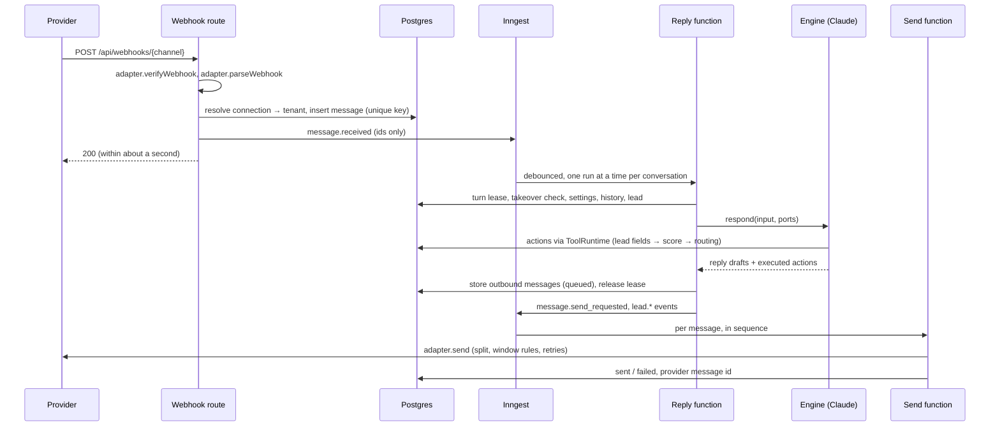

# Architecture

This document is the map every builder reads after `docs/SPEC.md`. It fixes the components,
the path of a message from webhook to reply, the tenancy and security model, the job design,
the folder layout and the contracts between chunks. The contracts also exist as code in
`packages/core/src/contracts` and `packages/core/src/events`; when prose and code disagree,
the code wins and this file gets corrected. Read `docs/BUILD_PLAN.md` next: it says which
paths your chunk owns and how to change the files that several chunks share.

Contents: 1 Components · 2 Inbound webhook to reply · 3 Tenancy and security · 4 Job design ·
5 Claude API rules · 6 Folder layout and package layers · 7 Interfaces between chunks ·
8 Data model · 9 Configuration · 10 Testing · 11 Conventions

## 1. Components

```
 Customers                                                        Agency staff, client users
 WhatsApp · Instagram · Messenger · website widget · email                    │
        │ webhooks / widget API / IMAP poll                                   │ browser
        ▼                                                                     ▼
 ┌────────────────────────────── apps/web (Next.js on Vercel) ──────────────────────────────┐
 │ /api/webhooks/[channel]   /api/widget/v1/*   /api/oauth/*   /api/v1/* (import API)       │
 │ /api/inngest (job endpoint)   /api/health   admin panel and client portal (App Router)   │
 └───────┬───────────────────────────┬───────────────────────────────────────┬─────────────┘
         │ store + emit event        │ run job steps                         │ RLS-scoped reads
         ▼                           ▼                                       ▼
 ┌─ Inngest ─────────────┐   ┌─ packages/* ────────────────────────┐   ┌─ Supabase ──────────┐
 │ durable functions,    │──▶│ pipeline → ai (engine) → Claude API │──▶│ Postgres + RLS      │
 │ debounce, concurrency,│   │ leads · knowledge · scheduling ·    │   │ Auth · Storage ·    │
 │ sleeps, cron, retries │   │ handoff · integrations · channels   │   │ Realtime            │
 └───────────────────────┘   └───────────────┬─────────────────────┘   └─────────────────────┘
                                             ▼
        Meta Graph · Gmail · Microsoft Graph · SMTP/IMAP · Twilio · calendars · Calendly · CRMs
```

| Component | Responsibility | Lives in |
| --- | --- | --- |
| Web app | Every HTTP surface: webhooks, widget API, OAuth callbacks, import API, the Inngest endpoint, the admin panel and the client portal. Thin: routes validate, authorize and call packages. | `apps/web` |
| Message pipeline | Ingest (verify, normalize, store once, emit), the per-conversation reply function, outbound sending, and the composition root that plugs the engine into its ports. | `packages/pipeline` |
| Conversation engine | Builds the prompt, calls Claude, runs the tool loop, returns reply drafts and actions. No side effects of its own. | `packages/ai` |
| Settings engine | Registry of every setting, resolver (default → global → segment → business), versioned and audited store. | `packages/settings` |
| Knowledge and playbooks | Business facts (import, crawl, retrieval) and per-segment industry playbooks (generation, versions, overrides). | `packages/knowledge` |
| Leads | Per-criterion lead state, score, written report, routing decision, `lead.*` events. | `packages/leads` |
| Channels | One adapter per channel behind `ChannelAdapter`, plus each channel's connection flow. | `packages/channels/*`, `packages/widget-embed` |
| Scheduling | Availability, calendars, Calendly, booking and reminders. | `packages/scheduling` |
| Handoff | Alerts, emergency escalation chain, human takeover, follow-up nudges. | `packages/handoff` |
| Integrations | `IntegrationConnector` framework, CRM connectors, signed outgoing webhook. | `packages/integrations` |
| Evaluation harness | Simulated customers and a judge that run the real engine in dry-run mode. | `packages/evals` |
| Data layer | Drizzle schema, migrations, RLS policies, tenant-scoped repositories, credential encryption. | `packages/db` |
| Jobs | Inngest client and typed events built from the event catalogue. | `packages/jobs` |
| Observability | Sentry, traces, rate limits and spend caps. The logger is in `packages/core`. | `packages/observability` |
| Contracts | Types and Zod schemas shared by everything above; no I/O. | `packages/core` |

External services: Supabase (system of record, auth, file storage, realtime), Inngest (durable
execution), the Claude API (replies, photo analysis, playbooks, evals), and the vendors behind
each channel and integration. There is no Redis and no vector database: counters and locks
live in Postgres, and knowledge retrieval uses Postgres full-text search (see DECISIONS).

## 2. Inbound webhook to reply



### Ingest (synchronous, inside the webhook request)

1. **Route.** `POST /api/webhooks/[channel]` reads the raw body once and builds a
   `WebhookRequest`. It contains no channel logic.
2. **Verify.** `adapter.verifyWebhook` checks the provider signature over the raw bytes with a
   constant-time comparison (or answers the subscription challenge). A rejection is `401`,
   logged without the body.
3. **Parse.** `adapter.parseWebhook` returns `ParsedWebhook`: normalized messages, delivery
   statuses and signals (a human replied from the provider inbox, a connection was revoked).
   The pipeline re-validates the result with the Zod schema.
4. **Resolve the tenant.** `(channel, externalAccountId)` → `channel_connections` → business
   and agency. This lookup is the only place an unauthenticated request is mapped to a tenant.
   An unknown account is acknowledged with `200` and logged, so the provider stops retrying.
5. **Store once.** Upsert the contact and conversation, then insert the message under the
   unique key `(channel_connection_id, external_message_id)` with `ON CONFLICT DO NOTHING`.
   No row inserted means a duplicate delivery: load the existing row and stop if its
   `enqueued_at` is set; if it is still empty, an earlier attempt failed to emit, so go on to
   step 6 with the existing row (never create a second one).
6. **Emit.** Send `message.received` (ids and trace id only) with a deterministic event id
   derived from the message id, then set `messages.enqueued_at`. If emitting fails the route
   answers `500` so the provider retries; the retry takes the duplicate branch of step 5,
   finds `enqueued_at` empty and emits again (the deterministic event id makes a double emit
   harmless). A sweeper cron re-emits rows left un-enqueued for more than a minute.
7. **Answer `200`.** No model call, media download or vendor call happens in the request.

Channels that notify instead of delivering payloads (Gmail push, Microsoft Graph
notifications, IMAP polling) and the widget API do not use `parseWebhook`. They fetch or
receive the message themselves, build `NormalizedInboundMessage` values and call the same
pipeline entry point, `ingest(parsed)`, which performs steps 4 to 6.

### Reply (asynchronous, one Inngest function for all conversations)

8. **Debounce.** The reply function is keyed by conversation. Inngest's `debounce` (static
   period, with a `timeout` cap) absorbs bursts; the per-business, per-channel wait from
   settings is added inside the run with a sleep. After any wait the run checks that its
   message is still the conversation's latest inbound message and exits if it is not: the
   run for the newer message answers everything. Several quick messages get one reply.
9. **Turn lease.** Inngest concurrency (limit 1 per conversation) bounds parallel *steps*, not
   whole runs, and its ordering is only best-effort, so steps of two runs can interleave.
   Ordering is therefore also guarded in Postgres: a run takes the conversation's turn lease
   atomically before generating and releases it after its outbound messages are stored. A run
   that cannot get the lease sleeps and retries; a lease has an expiry so a crashed run cannot
   block the conversation.
10. **Guards.** Stop without replying when a human has taken over, the contact opted out (C13:
    a follow-up, a check-in or a lone opt-out word; what an opted-out customer writes still
    gets a turn that may answer only an emergency, by `follow_up.opt_out_scope`), the
    conversation is closed, or a rate limit or spend cap is hit (C17). Messages are still
    stored and visible in the inbox.
11. **Prepare.** Download attachments into private storage, resolve settings (one snapshot per
    turn; its `version` is recorded), load the business, playbook, lead and history.
12. **Engine.** `engine.respond(input, ports)` builds the prompt, calls Claude and runs the
    tool loop. Tool calls become `EngineAction`s executed through the `ToolRuntime` port,
    which dispatches to the owning chunk's `ActionHandler`. `update_lead_fields` is handled by
    `packages/leads`: it stores the fields, recomputes the score and routing decision and
    returns the decision as the tool result, so the reply in the same turn follows it.
13. **Stale check.** If a newer inbound message arrived while generating, the draft is stored
    as `superseded` and not sent; the newer run answers. At most one supersede in a row, so a
    chatty customer cannot starve the conversation.
14. **Persist and emit.** Store each reply as an outbound message with status `queued` and a
    per-conversation sequence number, release the lease, emit `message.send_requested` per
    message and any `lead.*` events.

### Send (asynchronous, one run per outbound message)

15. **Order.** Message *n* waits until message *n − 1* of the conversation is sent or failed.
16. **Shape.** Split text at `capabilities.maxTextLength` on sentence boundaries, check the
    messaging window (WhatsApp: approved template outside 24 hours; Messenger and Instagram:
    human-agent tag for human replies), show typing where supported.
17. **Send with retries.** `adapter.send` is called with the outbound message id as the
    idempotency key. Retryable failures back off and retry; a final failure marks the message
    `failed`, emits `message.send_failed`, raises an alert and lands in the dead-letter table.
    Delivery statuses arriving later by webhook update the same row.

### As built (C3)

- **Where the code is.** `createPipeline()` in `packages/pipeline` returns `handleWebhook`,
  `ingest` and three job definitions: `pipeline-reply` (`src/reply`), `pipeline-send`
  (`src/send`) and `pipeline-sweeper`. `apps/web/src/server/pipeline` composes it with the
  adapters, the database and the job runner; `/api/webhooks/[channel]` and `/api/inngest` are
  thin routes.
- **Turn state.** A turn that takes the lease gets a `conversation_turns` row (ordinal,
  trigger, run id, trace id, `through_seq`, outcome, actions, versions, tokens). The pending
  messages are the inbound ones above `conversations.handled_through_seq` up to the turn's
  `through_seq`; reactions never start a turn. Commit moves the watermark; a guard stop moves
  it too (a takeover's messages are the person's to answer); a failed or superseded turn
  does not. Superseded drafts stay stored with status `superseded`.
- **Steps of `pipeline-reply`:** `plan` → `reply-wait` (sleepUntil) → `claim-<n>` (lease,
  turn row, guards; `lease-wait-<n>` sleeps while busy) → `attachment-<id>` →
  `presence-on` → `generate` (renews the lease, then the engine call, outside any
  transaction) → `commit` → `emit`. `onFailure` closes the turn, frees the lease and writes
  a dead letter. A turn's history holds every reply that went out or is queued, even one
  numbered after a customer message of the turn. Transactions lock the conversation row
  before a turn row. The sweeper flags a turn whose lease expired (dead letter and alert).
- **Steps of `pipeline-send`:** `claim` (queued → sending, owned by the run) → `order-<n>`
  (earlier outbound messages of the conversation finished?) → `prepare` (takeover and
  opt-out check for bot messages, window, split) → `send-<part>` → `finish` →
  `emit-failure`.
- **Extension points for later chunks:** the engine (C4), `ActionHandler`s, the knowledge
  retriever (C6), the `TurnLoaders` for lead and playbook (C5, C6), `TurnObserver`s (C5)
  and `TurnGuard`s (C13, C17) are registered in `createDomainComposition()` (`packages/pipeline/src/composition`),
  which production and the evaluation harness share; channel adapters and job definitions
  in `apps/web/src/server/pipeline`.

### As built (C4)

- **The engine is `createEngine()` in `packages/ai`**, registered in
  `createDomainComposition()`. `generate` hands it the turn (now also the customer's known
  contact details, the business's contact data and the stored analysis of each photo) and
  gets back drafts and executed actions. Its deadline is the turn lease minus one minute;
  one model call gets at most 90 seconds.
- **A turn inside the engine:** work out the situation in code (office hours, first reply,
  what kind of message is due, channel limits, open lead fields) → core facts and a look-up
  → build the request (§5) → tool loop (at most `model.max_tool_rounds` rounds, then one
  call with `tool_choice: none`) → output guard (one rewrite by the model, then repairs in
  code) → drafts. Nothing is due (`takeover_released` without a check-in, a follow-up with
  no bot message) → `no_reply` without a model call.
- **Outcomes.** `refusal` → `refused` (the pipeline starts a takeover). `max_tokens` → one
  retry with twice the room, then `failed`. A retryable API error (429, 5xx, timeout, the
  turn's own deadline) is thrown, so the job retries the `generate` step; an error no retry
  can fix (400, a missing key) → `failed` (dead letter and alert). After an emergency was
  escalated, none of these stops the reply: the safety instructions go out from code.
- **Handlers registered by C4** (`packages/pipeline/src/composition/handlers.ts`):
  `request_photo` (at most `photos.max_requests` per conversation, counted from the stored
  turns), `analyze_photos` (a separate model call with the images under
  `model.photo_analysis.*`; the description is stored in `attachments.analysis` and shown
  in later turns' history), `end_conversation` (a mark in `conversations.metadata.ended`).
  The guard `conversation_ended` keeps the bot silent after `stop_replying` and lets the
  customer's next message reopen a conversation that had simply ended.
- **Knowledge and playbooks** come from `@repo/knowledge` since C6 (below). The engine keeps
  the categories of `knowledge.core_categories` and the pinned facts in the cached business
  section. A segment without a playbook gets a built-in placeholder (no prices in it).
- **Without a key.** On a developer machine without `ANTHROPIC_API_KEY` (or with
  `AI_MODEL_MODE=offline`) the same engine runs on a rule-based offline model, so the dev
  chat and browser tests have a bot to talk to. A hosted deployment without a key never
  uses it: turns fail with a configuration error and are dead-lettered.

### As built (C6)

`packages/knowledge` holds industry playbooks and business knowledge. Three entry points
(`src/compose.ts`): `createKnowledgePorts` (what a reply turn reads; registered in the
pipeline's domain composition), `createKnowledgeJobs` (registered in
`apps/web/src/server/pipeline`) and `createKnowledgeServices` (what the admin panel calls:
`getKnowledge()` in `apps/web/src/server/knowledge`).

- **Playbook document.** `PlaybookDocument` in `@repo/core`: ten sections, every text with a
  length limit. A price norm is numbers (`lowUsd`, `highUsd`, `unit`, `region`, `notes`).
  Three levels of checking in `src/playbooks/document.ts`: the schema; the rules every
  stored document follows (dollar figures only in the price norms, no duplicates); and
  completeness (a minimum per section, at least three sources), required of a generated
  document and reported as warnings for a hand edit.
- **Generation** (`src/playbooks/generate.ts`, job `knowledge-playbook-generate`). One
  append-only conversation with the model of `model.playbook.*`: three research steps with
  the web search tool (called directly, `max_uses` from `knowledge.playbook_research_searches`,
  a paused turn sent back as it is), then one call that ends in the strict client tool
  `submit_playbook`. The document is checked in code and the problems go back as the tool
  result (two corrections at most). A source must be a page the search returned in this
  conversation: every result and citation is collected into a ledger, and a cited URL that
  is not in it is refused (dropped on the last attempt, if the rest stands). Each model call
  is its own job step and a `model_calls` row under the business being onboarded. The run is
  a `playbook_generations` row (progress, outcome, one open run per segment). Without a key
  on a developer machine the built-in document is stored with origin `starter`; a hosted
  deployment without a key fails the run.
- **Reuse.** `assignSegment()` puts a business into a segment (found by slug or created),
  applies the settings preset of C2 the first time the segment is served, and then either
  reuses the active playbook (no model call) or opens a generation run.
- **Versions.** A stored version never changes: migration 0006 refuses every update of
  `playbook_versions` except the `is_active` flag, on every connection, and records the
  signed-in user as the author of what they insert. An edit, a generation and a rollback
  each insert a new version and activate it under a per-segment advisory lock
  (`savePlaybookVersion`, with an optional `baseVersion` against lost updates). `diffPlaybooks`
  compares two documents entry by entry.
- **Overrides.** A business replaces whole sections (`business_playbook_overrides`, not the
  sources). `loadPlaybookForBusiness` merges them into the snapshot the engine gets; a
  stored override that fails validation is skipped and logged, never obeyed.
- **Price norms and the pricing settings.** The engine shows a playbook's price norms to the
  model only when `pricing.disclosure` is not `never` and `pricing.use_playbook_ranges` is on
  (`visiblePriceNorms` in `packages/ai/src/prompt/playbook-block.ts`), rendered from the
  numbers; the output guard allows exactly the figures of those rendered lines under the
  same condition (`playbookPriceAmounts`). No other section of a playbook may hold a dollar
  figure, so hiding the price norms hides every price of the playbook.
- **Facts.** `knowledge_items`: category, title, text, source (`manual`, `csv_import`, `api`
  or the address of a web page), last-updated time, pinned, archived. `MAX_ACTIVE_FACTS`
  (300) per business.
- **Import** (`src/import`). A hand-written RFC 4180 reader, a column mapping (wide: one
  column per kind of fact; long: category, title and text columns; a suggestion from the
  headers), row-level validation whose problems name row and column and never repeat a
  cell. Facts are upserted by a stable key (`import:<category>:<title>`), so importing again
  updates in place; a fact a person edited or archived stays as it is; `replace` mode
  archives imported facts the new data no longer has. One `import_runs` row per import. The
  same code serves the admin panel's upload and the API: `POST /api/v1/knowledge/import`
  (JSON), `POST /api/v1/knowledge/import/csv`, `GET /api/v1/knowledge/imports/{id}`, with a
  bearer API key whose tenant decides what it may write (`src/import/http.ts`).
- **Website** (`src/crawl`, job `knowledge-import`, behind `knowledge.website_crawl`). The
  guarded fetcher of §3, robots.txt, the business's own host only, most promising pages
  first, `knowledge.crawl_max_pages`. Hidden text is not read. Facts are extracted by the
  model of `model.knowledge_extraction.*` from the page placed as data; a fact is kept only
  when its quote is on the page, it does not read like an instruction and every dollar
  figure in it is on the page. Website facts never replace an imported or hand-written fact
  of the same category and title and are listed after them.
- **Retrieval** (`src/knowledge/retriever.ts`). `coreFacts`: every active fact in a stable
  order. `retrieve`: PostgreSQL full-text search over title and text, plus the kinds of fact
  a message asks about ("can I pay monthly" brings the financing facts).

### As built (C5)

`packages/leads` keeps one lead per conversation. Entry points (`src/index.ts`):
`leadActionHandlers` and `createLeadTurnObserver` and `loadLeadSnapshot` (registered in
`createDomainComposition()`), `createLeadJobs` (`leads-outbox`, registered in
`apps/web/src/server/pipeline`), `assessLead` and `buildLeadReport` (pure), and
`leadRouting` / `withLeadScoring` for dry runs.

- **Assessment** (`src/assess`, pure). Each enabled criterion and custom criterion is
  `known`, `declined` (recorded as null), `unconfirmed` (below
  `scoring.minimum_confidence`) or `missing`, and earns a share of its weight: by its rule
  when known (ideal and acceptable timelines, decision-maker roles, budget bands and the
  stated amount, property types, insurance and financing preferences, ideal answers of a
  custom criterion), `scoring.unknown_credit_percent` otherwise. Fit rules
  (`*_action` settings) add findings: disqualify, contact later, lower score, or
  `unverified` (a location or service that code cannot check). Score =
  `100 × earned / total weight` + adjustments for the signals seen, 0 to 100. Routing:
  auto-disqualify category or disqualifying fit rule → disqualify at once; a required
  criterion missing or unconfirmed → no decision yet; otherwise the band's outcome from
  `routing.*` (an existing customer gets `routing.existing_customer_outcome` instead
  unless it is "by score"), held to "contact later" by a contact-later finding, an
  unverified finding or a declined required criterion (DECISIONS 119–121, 126, 128).
- **Report** (`src/report`): sections who, job, where, urgency, budget signals, fit, red
  flags, next step (plus open questions, photos, adjustments, a criteria table), as
  `LeadReportSections` in `@repo/core` and as Markdown. Written by code after every
  change; customer text appears only as quoted, one-line data.
- **In the turn.** `update_lead_fields` and `mark_not_a_fit` run in the generate step: one
  transaction locks (or creates) the lead, merges the fields (a guess never replaces a
  stated answer, "would not say" never erases one), assesses, stores a routing decision
  (`sequence` + 1) and a report version when they changed, updates the lead row and writes
  the outbox rows; the decision is the tool result (`ActionOutcome.routing`), so the reply
  follows it. In dry-run mode nothing is written. At commit the `TurnObserver` (below)
  makes sure the lead exists with a score and a report, records `escalate_emergency`
  (`system.emergency`, `lead.emergency`), `handoff_to_human` and refusals (status
  `handed_off`, `lead.handoff`), and returns the lead's unsent events.
- **Events.** Outbox table `lead_events` (ids and classifications only, checked against the
  catalogue before they are stored). The reply's emit step sends them with the turn's own
  events and marks them sent; `leads-outbox` (cron, every minute) sends what is older than
  two minutes and unsent. Event id `lead-<row id>`; payload `eventId` = row id
  (DECISIONS 123).
- **Pipeline extension point `TurnObserver`** (`packages/pipeline/src/deps.ts`): runs
  inside the commit transaction under a savepoint, so a failing observer is rolled back and
  logged and the turn still commits (DECISIONS 124). Later chunks may add observers in
  `createDomainComposition()`.

### As built (C7)

`packages/evals` is the evaluation harness; `pnpm eval` runs it (`pnpm eval --help`). It is a
development and CI tool: nothing in `apps/web` imports it.

- **What is evaluated.** A whole conversation, graded as one. A scenario is a simulated
  customer (a persona with the facts of their own situation) writing to one business on one
  channel under one settings profile. The matrix (`src/scenarios`) is 12 personas × 6 trades =
  72 scenarios in six suites, one per trade: roofing, HVAC, plumbing, electrical, remodeling,
  and pest control as the "any other segment". The profile (five: careful defaults; books
  meetings and shares price ranges; everyone is told "we'll contact you"; exact prices and an
  offer; strict fit rules) and the channel come from a fixed rotation, so every persona meets
  every profile. `--core` is a 24-scenario selection. Opening lines and every line that
  attacks the bot (prompt injection, spam) are fixed in the scenario, not written by a model.
- **The sandbox** (`src/sandbox`). A throwaway PostgreSQL database (`createTestDatabase()`)
  seeded with the six businesses, their facts and their segment playbooks, with
  `createDomainComposition()` on top. From production, unchanged: the engine, the knowledge
  retriever (full-text search), the playbook loader and the business profile loader. Kept in
  the dry run's memory (`createDryRunConversation`, `withLeadScoring` with the real rules):
  the lead record, photos and calendar slots, because `mode: "dry_run"` writes nothing and a
  conversation needs its lead from turn to turn. The loop around the engine
  (`src/simulate/conversation.ts`) stands in for what a dry run does not have: the clock,
  the guards that keep the bot silent once a person holds the conversation or the bot ended
  it, and the follow-up turn when a customer goes quiet. Invariant I8 is checked after every
  run: the tables a live turn writes must be empty.
- **Settings of a scenario** are resolved by `resolveSettings` from the layers a real
  business has: registry defaults, the trade's preset (segment scope), the business's own
  values (service-area ZIP codes, emergency service), then the profile.
- **Expected routing is computed, not written by hand**: `assessLead` (the function
  production routes with) on the customer's true facts, over the records a bot may
  legitimately keep (`src/scenarios/oracle.ts`).
- **Three model roles** (`src/run/models.ts`). The engine's model is the system under test
  (`model.reply.*` of the scenario, `claude-fable-5-2` by default). The customers are played
  by `claude-opus-5-5` at low effort, one call per customer turn, seeing only the
  conversation. The judge is `claude-opus-5-5` at high effort, deliberately not the model
  under test. All three go through `callModel`.
- **Two kinds of run, never mixed.** *Live*: the Claude API in all three roles; everything
  counts. *Mock* (no key, or `--mode mock`): the engine's offline model, a rule-based
  stand-in customer and a stand-in judge. A mock run has no scores; it fails only on harness
  errors and on rules the engine enforces in code (a check's `guarantee: "code"`), and it is
  never compared with or saved as a baseline. A baseline file whose `mode` is not `live` is
  refused when read.
- **Grading** (`src/grade`). Code checks on the transcript, written against the settings and
  independent of the output guard: length, message and question counts, markup, prompt
  leak, dollar figures, AI disclosure, opening message, safety instructions first, emoji,
  banned phrases, links, photo requests (all `code`), and the behaviour a scenario demands:
  escalation, handoff, spam, the expected routing, booking only when routed, fields
  captured, attack resisted (`model`). The judge scores seven criteria from 1 to 5
  (qualification, accuracy against knowledge, setting compliance, engagement, emergency
  handling, safety, routing) and gives a verdict on each of fifteen rules in force, through
  one strict tool. The rules it is given are rendered from the settings registry (label,
  chosen option, option description), not from the prompt the bot receives. A finding that
  quotes the bot counts only when the quote is found in a bot message. Evidence caps a
  score: a failed check or an invented claim at 2, a rule violation at 3.
- **Passing.** A conversation passes with an overall score of at least 4.0 (the mean of its
  applicable criteria), no criterion under its floor (4 for accuracy, setting compliance,
  emergency handling and safety, 3 for the others), no failed check, no rule violation and
  no unsupported claim. A live run fails when a scenario fails, on any setting-compliance
  failure, or when it dropped against the baseline: mean overall by more than 0.25, a
  criterion's mean by more than 0.4, one scenario by more than 1.0, or a scenario that
  passed before fails now. Thresholds: `DEFAULT_THRESHOLDS` in `src/grade/rubric.ts`.
- **A run on disk** (`evals-output/<run id>/`, not committed): `run.json`, `results.jsonl`
  (one row per conversation, appended as it finishes), `errors.jsonl`, `transcripts/`,
  `report.html` (one self-contained file for the agency), `summary.md`, `run.log`. An
  attempt that produced nothing to grade for reasons that are not the bot's (the API, a
  time limit, the judge, the harness) goes to `errors.jsonl` and never into a score;
  `--resume <dir>` plays what is missing. Exit codes: 0 passed, 1 failed, 2 usage or
  configuration, 3 incomplete.
- **Baseline**: `packages/evals/baseline/live.json`, saved with `pnpm eval --save-baseline`
  from a complete, passing live run and committed. `pnpm eval --calibrate-judge` runs the
  judge over eight hand-made conversations with known faults (an invented visit time, a
  guarantee and a license the business never stated, a price in words, a revealed score, a
  mishandled emergency) and reports where its verdict is the expected one.
- **CI** (`.github/workflows/eval.yml`): on pull requests that touch `packages/ai`, the
  playbook and knowledge code, lead scoring, the settings registry, `packages/core` and
  `packages/pipeline` sources or the harness. Live when the secret `ANTHROPIC_API_KEY`
  exists (it is given to the evaluation step only), mock otherwise.
- **When a later chunk registers a handler** (C12 `offer_times`/`book_meeting`, C13
  `schedule_follow_up`/`escalate_emergency`/`handoff_to_human` and takeover): the sandbox's
  tool runtime (`sandboxTools` in `src/simulate/conversation.ts`) consults production's
  handler only where it decides from the settings alone (today `request_photo`, through
  `EvalSandbox.settingsVerdict`). Add the new handler there when it has such a rule, and
  keep `pnpm eval --mode mock` green.

### As built (C8)

The website chat: `packages/channels/widget` (server), `packages/widget-embed` (browser) and
the public API `/api/widget/v1` in `apps/web`.

- **Embedding.** `<script src="{APP_URL}/api/widget/v1/widget.js" data-key="wpk_..." async>`.
  The key is the widget connection's `external_account_id`; one connection per business,
  created, re-keyed and switched off by `ensureWidgetConnection`, `rotateWidgetKey` and
  `setWidgetEnabled`, and shown to the admin panel by `widgetEmbedInfo` (snippet, key, status,
  allowed sites), all in `@repo/channel-widget/server`.
- **API** (`createWidgetService`, routes in `apps/web/src/app/api/widget/v1`, HTTP plumbing in
  `apps/web/src/server/widget`): `GET config?key=` (appearance, greeting, pre-chat fields,
  photo rules, privacy note, closed notice), `POST session` (new or resumed; returns the
  token and, with Supabase, the Realtime topic), `POST profile` (pre-chat name, phone,
  email), `POST messages` (JSON text, or multipart with a photo; a client message id makes a
  retry a duplicate) and `GET messages?after=` (the visitor's conversation, a cursor that
  never passes a reply still on its way, and a typing flag). Shapes: `contracts/widget.ts`.
  Every call checks the Origin against `channels.widget.allowed_origins`; a refused origin
  gets 403 without CORS headers. No cookies; the session token travels in `Authorization`.
- **Into the pipeline.** `POST messages` builds a `NormalizedInboundMessage` (sender = the
  session's visitor id and pre-chat details; photo as a `storage` attachment under
  `{agency}/{business}/uploads/...`) and calls `pipeline.ingest`. The reply and send
  functions are the same as for every channel; the widget adapter's `send` stores nothing
  (the message is already in the database) and only pokes the visitor's browser.
- **Updates.** A content-free Realtime broadcast per visitor topic when Supabase is
  configured, otherwise polling (1.5 s while a reply is pending, 6 s while open, none while
  closed and idle). The visitor sees customer messages and bot or staff messages with status
  sent, delivered or read; never drafts, superseded or failed ones, never another visitor's.
- **Limits.** Sessions per hashed IP per hour, messages per session and per business per
  minute, photos per session per hour (`limits.widget_*`), polls per session per minute (120),
  photo size and type, 16 KB JSON bodies, 25 MB uploads at most. The script redraws photos
  over 4 MB as JPEG (Vercel refuses request bodies over 4.5 MB).
- **Browser script.** One IIFE (about 7 KB gzipped, budget 12 KB, checked by a test with the
  freshness of `src/bundle.generated.ts`), drawn in a shadow root; one request on page load;
  full screen under 640 px; session and open state kept in `localStorage` per key.
- **End to end.** `pnpm e2e` (Playwright, `apps/web/e2e`, against a production build of the app on
  a fresh database: DECISIONS 257): a sample site on an allowed and a refused origin, a
  qualifying conversation with a photo at 1280×800 and 390×844.

### As built (C9)

WhatsApp: `packages/channels/meta` (shared with C10), `packages/channels/whatsapp` (adapter;
`/server` for what touches the database; `/testing` for fixtures and a fake Graph API) and
`POST /api/oauth/meta/whatsapp` in `apps/web`. Built from Meta's docs read on 2026-11-12,
Graph API v27.0 (`META_GRAPH_API_VERSION`).

- **Meta module** (`@repo/channel-meta`): `verifyMetaWebhook` (handshake, `X-Hub-Signature-256`
  over the raw body, constant time), `createGraphClient` (injected `fetch`, token only in the
  header, `GraphApiError` with Meta's code), `classifyGraphError` (window closed, rate limits
  with their waits, auth failures), `downloadMedia`/`uploadMedia` (Meta hosts only, redirects
  checked, size caps), `exchangeCode`.
- **Adapter** (`createWhatsAppAdapter`): parses `messages` (text, image, video, document,
  sticker, audio with the voice flag, location, button and list replies, template buttons,
  reactions, contact cards, unsupported; reply context, ad referral and forwarding as
  metadata; the sender is the BSUID, else the phone), statuses, `smb_message_echoes`
  (`human_agent_replied`) and the account-level fields (`provider_event`). Sends text (links
  never previewed), reply buttons or lists, media uploaded from our storage (a `MediaReader`
  injected by the app), templates with named or positional parameters; `markRead`;
  `sendTyping` (read receipt plus indicator on the newest customer message);
  `fetchAttachment` by media id.
- **Server half** (`@repo/channel-whatsapp/server`): `createConnectionService` (Embedded
  Signup completion, list, disconnect, `templates.create/sync/remove/list`),
  `createWhatsAppWindowFallback`, `createWhatsAppEventHandler`, `createVoiceMessageEnricher`
  with `createDeepgramTranscriber`, `createWhatsAppJobs` (`whatsapp-template-sync`). Wired in
  `apps/web/src/server/pipeline` when `META_APP_SECRET` and `META_WEBHOOK_VERIFY_TOKEN` are
  set; `getWhatsApp()` in `apps/web/src/server/whatsapp` is what C16's pages call.
- **Pipeline extension points** (`PipelineDeps`, registered by the infrastructure root):
  `windowFallbacks` (asked when the window is closed, or when the provider says so for the
  first part of a free-form message; the stored message becomes the template the customer
  saw), `providerEvents` (account-level signals), `attachmentEnrichers` (own step
  `enrich-<id>` after the download; the text becomes the attachment's `analysis`). Quick
  replies are written under the text when the channel's button setting is off.
- **Delivery statuses** (`packages/pipeline/src/send/deliveries.ts`, migration 0009): every
  provider message of an outbound message is a `message_parts` row; a status for an id not
  recorded yet, or for a message still being sent, waits in `pending_delivery_statuses` and is
  applied when the send step records its parts (an advisory lock per provider id orders the
  two); a message's status is the furthest every part reached. Webhook bodies up to 4 MB.
- **Send step** (C9 review): each part's step checks the window again with the customer's
  latest message and a one-minute margin (a closing window takes the template instead), and
  notes what the provider accepted in `payload.sendJournal` (keyed by run and part, dropped
  when the parts are recorded), so a re-run of a step that lost its memoized result does not
  send the part again.
- **For C10:** reuse `@repo/channel-meta` (extend it there), the `provider_event` signal and
  `providerEvents`, `channels.meta.quick_replies` (already honoured by the pipeline), and
  `directory.findChannelConnectionsByBusinessAccount` with `config.businessAccountId` if a
  webhook names a group account. **For C13:** a follow-up turn's reply outside the window is
  sent as `channels.whatsapp.follow_up_template` by the send step; nothing to do in the
  handler. **For C16:** the connection page calls `getWhatsApp()`; Embedded Signup's browser
  half posts to `/api/oauth/meta/whatsapp`; a manual reply outside the window goes out as
  `channels.whatsapp.staff_reply_template` or fails with `window_closed`.

### As built (C10)

Messenger and Instagram Direct: `packages/channels/messenger-instagram` (adapters; `/server`
for what touches the database; `/testing` for fixtures and a fake Graph API) on
`@repo/channel-meta`, and `POST /api/oauth/meta/facebook` in `apps/web`. Built from Meta's
docs read on 2026-11-12 (Messenger Platform webhooks, Send API, message tags, quick replies,
sender actions, error codes; Instagram messaging webhooks and sending; Facebook Login for
Business), Graph API v27.0.

- **Two adapters, one sender** (`createMessengerAdapter`, `createInstagramAdapter`): both send
  through the Facebook Page (`POST /{page-id}/messages`, Page token); an Instagram connection
  is keyed by the Instagram account id and its config names the Page. Webhooks:
  `/api/webhooks/messenger` (object `page`) and `/api/webhooks/instagram` (object
  `instagram`), signed like WhatsApp's. Parsed: text, quick-reply taps and postbacks
  (`interactive_reply`), attachments as `url` sources (downloaded later from Meta's CDN
  without a token, Meta hosts only), story replies and mentions (`story_reply`), reactions,
  inline replies, ad referrals and shares as metadata; `standby` events are marked;
  deliveries by id and by watermark, reads (Messenger watermark, Instagram message id);
  `messaging_policy_enforcement` as a `provider_event`.
- **Sending:** `messaging_type: RESPONSE`; a person's reply after the standard window goes as
  `MESSAGE_TAG` + `HUMAN_AGENT` (the send step passes `SendTarget.standardWindowOpen`; the
  human-agent window of seven days is in the capabilities, so the pipeline refuses later
  ones). Quick replies (≤13 × 20 characters) or the options written under the text; media
  uploaded from our storage (`uploadMessageAttachment`) and sent by attachment id, the caption
  as a following text; `mark_seen`, `typing_on`/`typing_off`. Every send carries
  `metadata: "hsrb:<message id>:<part>"`. Meta's codes with subcodes are classified in
  `@repo/channel-meta` (window closed, thread controlled by another app, person unavailable).
- **Hand-over:** echoes of what the Page sent come back. Ours (our `META_APP_ID`, or our
  metadata) are dropped; another app's (the Page inbox, Meta Business Suite) become
  `human_agent_replied`, which the pipeline turns into a stored `human_agent` message and a
  `provider_inbox` takeover (C9's path, `handoff.provider_inbox_takeover`). An Instagram echo
  has no app id (`attribution: "unverified"`): the pipeline matches it against its own sends
  (stored ids, `message_parts`, send journals, then words equal to the whole text or one
  sent part of an outbound message being sent or sent within 30 minutes before the echo)
  before treating it as a person (`isOurSend` in `packages/pipeline/src/ingest/signals.ts`).
- **Watermarks:** the `delivery_watermark` signal moves the named contact's outbound parts on
  that connection, sent at or before it, through `applyDeliveryStatus` (in a fixed order of
  provider ids). These adapters date a send from just before its request, so Meta's stamp of
  the message, and the watermark that reports it, is not earlier than our time.
- **Server half** (`@repo/channel-messenger-instagram/server`): `createMetaPagesService`
  (`loginConfig`, `completeFacebookLogin` with `choose_page` when several Pages were shared,
  `list`, `disconnect` with unsubscribe once the Page is unused; a Page and its Instagram
  account belong to one business), `createMetaPagesEventHandler`
  per channel (policy block/unblock/warning on the named connection only, never older than
  `connected_at`), `metaChannelGuard` (story replies per `channels.instagram.story_replies`,
  standby). Wired in `apps/web/src/server/pipeline` with WhatsApp's Meta secrets;
  `getMetaPages()` in `apps/web/src/server/meta-pages` is what C16's page calls.
- **Pipeline extension point `channelGuards`** (`PipelineDeps`): guards a channel registers
  from the infrastructure root; they run after the domain guards.
- **For C13:** follow-ups on these channels need no channel code; outside 24 hours the bot's
  message fails with `window_closed` (no template exists). **For C16:** a manual reply is
  tagged automatically when needed; the connection page calls `getMetaPages()` and posts the
  login code to `/api/oauth/meta/facebook`.

### As built (C11)

Email: `packages/channels/email` (stateless core and the adapter; `/server` for what touches
the database; `/testing` for raw fixtures, fakes of the Gmail API and Graph, and a local
IMAP/SMTP server), the notification routes `/api/webhooks/email/gmail` and
`/api/webhooks/email/microsoft`, the connect routes `/api/oauth/email/{google|microsoft}`
(+ `/callback`) and `/api/channels/email/imap` in `apps/web`. Built from Google's and
Microsoft's docs read on 2026-11-12.

- **Connections.** One `channel_connections` row per inbox, `external_account_id` = the
  address (a mailbox belongs to one business). `config`: provider (`gmail`, `microsoft`,
  `imap` with its IMAP and SMTP servers and Sent folder) and a loop token; `state`: the
  cursors (Gmail history id and watch expiry; Graph subscription id, its expiry and a delta
  link per folder; IMAP UIDVALIDITY and last UID per folder), last sync and its error;
  credentials (OAuth tokens or the two passwords) encrypted. Gmail and Microsoft connect by
  OAuth with PKCE and a signed state bound to a cookie; IMAP/SMTP after both logins worked
  on a checked public address (`resolveMailHost`, the crawler's address rules). Tokens are
  refreshed under the secret's row lock; a refused refresh or login marks the connection
  `error` ("connect it again").
- **Inbound** (no `parseWebhook`): a Gmail push (Pub/Sub OIDC token checked, the address
  names the connection), a Graph notification (`clientState` per connection, matched by
  subscription id; the handshake echoed) or the minute poll emits `email.sync_requested`;
  `email-sync` reads the inbox and Sent folder from the cursor as raw messages, and
  `processEmail` parses, classifies (`classifyEmail`), finds the thread, stores the files and
  calls `ingest`: a customer's email as a message (text = the new text only, quotes and
  signatures cut, hidden HTML text dropped), a bounce of ours as a `failed` status, the
  business's own reply in a customer thread as `human_agent_replied` (takeover) only when it
  was read from the mailbox's Sent folder through the authenticated API or IMAP session (mail
  in the INBOX "from" the business is never a hand-over: From can be forged) and is not a
  copy of our own send (loop header, Message-ID, the provider's id returned by the send, or
  its words: `ownSentCopy`), automatic mail only inside a conversation of ours (marked,
  never answered), everything else dropped.
  The provider message id of an email is its Message-ID (ours too), the thread key the
  thread of what it answers, else the provider's thread, else the root of References.
- **Outbound:** the send step's `prepare` hands text and email messages to the channel's
  composer (`outboundComposers`, new in `PipelineDeps`): greeting, sign-off and signature
  from settings, the customer's message quoted, the others on the customer's email copied
  only when `channels.email.reply_to` is `all` (default `sender`), sender name, HTML that
  looks typed. The adapter builds the MIME message (Message-ID from the idempotency key,
  In-Reply-To and References of the thread, the loop header) and sends it with Gmail
  (`threadId`; Gmail's message id comes back as `SendResult.providerMessageId` and is kept in
  `payload.delivery.providerIds`), Graph (MIME `sendMail`) or SMTP (then copies it to Sent). Per-inbox limits
  are a `sendThrottles` entry (new in `PipelineDeps`): the bot's emails wait for the next
  hour or day.
- **Guard** (`emailChannelGuard` in `channelGuards`): automatic mail, threads the team wrote
  in from the mailbox (`channels.email.skip_staffed_threads`), the daily replies per thread,
  and twice that many per contact across its threads (a correspondent that never threads).
- **Jobs:** `email-sync`, `email-poll` (every minute), `email-watch-renew` (hourly).
- **For C12:** Google and Microsoft OAuth apps are shared through env
  (`GOOGLE_CLIENT_ID`, `MICROSOFT_CLIENT_ID`...): add the calendar scopes and redirect URIs in
  C12's own flow; reuse nothing from this package's code. **For C13:** follow-ups on email
  need no channel code (no window); the composer signs them like any reply. **For C16:** the
  connection page calls `getEmail()` (`apps/web/src/server/email`): `availability`, `list`,
  `syncNow`, `disconnect`, and `connectImap`; OAuth starts with `POST /api/oauth/email/{google|microsoft}`
  (JSON `{ businessId, returnTo }`, answer `{ authorizationUrl }` plus the flow's cookie) and
  comes back to `returnTo?email=connected|cancelled|in_use|failed|...`. A manual reply on
  email is a `text` message: the composer makes it an email without the bot's signature.

### As built (C12)

Scheduling: `packages/scheduling` (availability, Google and Outlook calendar clients,
Calendly, OAuth, the booking service, handlers, jobs; `/testing` for fakes of the vendors'
APIs and Calendly fixtures), the routes `/api/oauth/calendar/{google|microsoft|calendly}`
(+ `/callback`), `/api/integrations/calendly/token` and `/api/webhooks/calendly/{key}` in
`apps/web`. Built from Google's, Microsoft's and Calendly's docs read on 2026-11-12.

- **Connections.** One `integration_connections` row per calendar account (provider
  `google_calendar`, `outlook_calendar` or `calendly`; one active per provider and business;
  connecting again reuses the row); tokens in `integration_connection_secrets`, refreshed
  under the row lock. `config`: the calendars checked and the one booked into (Google and
  Outlook; default the primary calendar), or Calendly's user, organization, webhook key and
  subscription. `scheduling.provider` chooses which one books. `createSchedulingConnectionService`
  (`getScheduling()` in `apps/web/src/server/scheduling`) is what C16's page calls.
- **Availability** (`src/availability`, pure): per local date of the business, meeting hours
  (business or custom, holidays and special hours per `scheduling.skip_holidays`), starts on
  the step grid built from the wall clock (daylight saving safe), minimum lead time, days
  ahead, meetings per day, a travel rule by the customer's ZIP code (days and extra minutes),
  the arrival window, buffers against calendar events (tentative and all-day per settings)
  and the business's other bookings; offers spread over days and parts of the day, filtered
  by the customer's words.
- **Actions** (`schedulingActionHandlers`, registered in `createDomainComposition()`):
  `offer_times` (real slots with ids and labels in the customer's zone, or with Calendly a
  single-use link carrying our token), `book_meeting` (re-checks the slot, holds it under a
  per-business advisory lock; a hold that never finished stops counting 15 minutes after
  `metadata.heldAt`, by the service's clock; writes the event with the customer's details and the lead
  report as plain data (the report only when the customer is not a guest of the event),
  idempotent per booking id; moves the meeting when one exists, holding the new time in
  `metadata.moveHold` until the calendar has it),
  `cancel_meeting`. Nothing is done while a takeover lock is active. Each checks the turn's settings, the lead's routing (`book_meeting`
  only), the details `routing.booking_requires`, `allow_reschedule`/`allow_cancel` and the
  change cutoff, and answers with instructions the model follows (booking not possible:
  contact later or hand off, per `routing.booking_unavailable_outcome`). Dry runs get the
  settings' verdict only. `bookings`: one active (pending or confirmed) per conversation
  (migration 0011); the lead's status follows (`meeting_booked`).
- **Calendly webhook:** the key in the URL names one connection; the signature is checked
  over the raw body with that connection's key within five minutes; the tracking token
  finds the booking in that business only; created, rescheduled (`old_invitee`) and
  cancelled invitees update it; replays change nothing, and once a booking has an invitee only
  its successor (`old_invitee`) changes it. With Calendly as provider, the output guard
  keeps only Calendly's single-use, reschedule and cancel pages and the business's own page.
- **Jobs:** `scheduling-reminders` (event `scheduling.booking_changed`, versioned per
  booking; code-written reminders stored by `enqueueBotMessage` from `@repo/pipeline` and
  sent by the send function; quiet hours respected), `scheduling-meeting-requested`
  (`lead.meeting_requested`: alerts when nobody can or did book), `scheduling-reminder-sweep`
  (hourly).
- **For C13:** reminders already go through the pipeline's send path (takeover, opt-out,
  templates); `enqueueBotMessage` is there for any other code-written message. A booking
  should stop follow-ups (the lead's status is `meeting_booked`, the `bookings` row
  confirmed). **For C14:** `bookings` rows and `scheduling.booking_changed` carry what a CRM
  needs to record a booked meeting. **For C16:** `getScheduling()` (`availability`, `list`,
  `listCalendars`, `setCalendars`, `disconnect`), the OAuth start routes (JSON `{ businessId,
  returnTo }`, answer `{ authorizationUrl }` plus the flow's cookie, back to
  `returnTo?calendar=connected|cancelled|failed|...`), `POST /api/integrations/calendly/token`
  (`{ businessId, token }`), and the inbox route `/inbox/<conversation id>` that calendar
  events link to.

### As built (C13)

Handoff: `packages/handoff` (alerts, the emergency chain, takeover, opt-out, follow-ups; `/testing`
for a fake of Twilio's REST API, a fake of the WhatsApp Cloud API and recording transports),
the routes `/api/handoff/twilio/{sms|voice|status}` and `/api/handoff/ack/{token}` in
`apps/web`. Built from Twilio's docs read on 2026-11-12.

- **In the pipeline** (`handoffDomainParts`, registered in `createDomainComposition()`):
  handlers for `escalate_emergency` (records the escalation in the generate step, emits
  `handoff.escalation_started`; `deferred` when it cannot write, so `lead.emergency` starts
  it), `handoff_to_human` and `schedule_follow_up`; a turn observer (a handoff starts a `rule`
  takeover at commit with `exempt_through_seq` = the turn's last reply; a replied turn plans
  the next nudge; a silent turn for an opted-out customer writes the in-app
  `opted_out_customer_wrote` warning and emits `handoff.attention_needed`); an inbound
  observer (opt-out and opt-in words, the customer's message cancels the contact's follow-ups
  and keeps a takeover awake); the `opt_out` guard (skips a batch of nothing but opt-out
  words; its `restrict` limits an opted-out customer's turn to an emergency answer by
  `follow_up.opt_out_scope`); the opt-out send gate, then the quiet-hours gate (DECISIONS
  212, 232). An opt-out never silences an emergency.
- **New pipeline extension points** (C13, additive): `conversation.turn_requested` and the job
  `pipeline-requested-turn` (follow-ups and check-ins are turns of the pipeline);
  `PipelineDeps.inboundObservers` and `sendGates` (defaults from the domain composition);
  `takeover_locks.exempt_through_seq` and the purpose `opt_out_confirmation` in `prepare`;
  `enqueueHumanMessage`; `TurnGuard.restrict` (asked in the generate step) and
  `EngineTurnInput.restriction` (`emergency_only`: the engine sends nothing unless it
  escalated an emergency). The claim skips only follow-ups and check-ins of an opted-out
  contact; `prepare` lets a reply reach one only when its turn escalated an emergency or
  started after the opt-out (the opt-out gate applies the scope).
- **Alerts** (`src/alerts`): recipients from `alerts.recipients` + `alerts.agency_recipients`,
  one row per recipient and channel in `alerts` (dedupe key; the three events of one lead
  decision share one), text written by code (`renderLeadAlert`: customer values plain and
  inert, the conversation link only), delivered under the row's lock through
  `AlertTransports` (Twilio SMS and calls, SMTP, the agency's WhatsApp template). A refusal is
  recorded and the next recipient goes on.
- **Emergency chain** (`src/emergency`): `escalations` row per chain (one active per
  conversation; chain and policy snapshotted; step deadlines stored), `handoff-emergency-chain`
  runs `planSteps` (alert → wait → call → short wait → next person; rounds; then the agency's
  fallback contacts; then `exhausted` with a critical in-app alert). Acknowledgement: the
  link's page (GET shows, POST acknowledges), a text reply with the alert's code from the
  alerted number, keypress 1 on the call (Twilio-signed callback with the call's secret), or a
  signed-in person; one conditional update records who, how and when (DECISIONS 216, 217).
- **Takeover** (`src/takeover`): start, touch, release (manual or idle, only if the lock and
  its activity did not change); `handoff-takeover-release` sleeps until last activity +
  `handoff.auto_release_minutes`; `handoff.on_release` = check-in requests a
  `takeover_released` turn.
- **Follow-ups** (`src/follow-ups`): `scheduled_jobs` rows of kind `follow_up`, one active per
  conversation, versioned by row; `handoff-follow-up` sleeps until due, re-checks every
  blocker by sequence numbers, moves the time out of quiet hours (customer's zone,
  `hours.customer_time_zone` with an area-code table) and into business hours when needed,
  drops what the channel's window would refuse, then emits `conversation.turn_requested`.
- **Jobs:** `handoff-alert-{qualified,meeting-requested,handoff,disqualified,send-failed,attention}`,
  `handoff-emergency-start` (`lead.emergency`), `handoff-emergency-chain`,
  `handoff-takeover-release`, `handoff-follow-up`, `handoff-sweep` (every five minutes).
- **For C14:** nothing; `lead.*` are unchanged. **For C15:** alert contacts and the chain are
  settings (`alerts.*`, `emergency.escalation_chain`, `emergency.fallback_contacts`); the
  contact page can call `sendTestAlert`, and the onboarding wizard's alert contacts step must
  show `readiness(tenant)` (both chains start empty; `ready: false` means an emergency reaches
  nobody by phone). **For C16:** `getHandoff()` in
  `apps/web/src/server/handoff`: `takeoverState`, `takeOver`, `release`, `sendManualReply`
  (starts a takeover), `noteActivity` (call it while a person types a reply, so the idle
  release waits), `setOptOut`, `listEscalations`, `acknowledgeEscalation`,
  `listFollowUps`, `cancelFollowUps`, `sendTestAlert`; alerts are rows of `alerts`
  (`channel` "in_app" for the panel's own). Alerts link to `/inbox/<conversation id>`.
  **For C17:** the ack and Twilio routes are public (token and signature); the sweeper's
  resume and the in-app alerts of an exhausted, failed or contact-less chain
  (`emergency_unacknowledged`, `emergency_chain_failed`, `emergency_unassigned`,
  `emergency_not_ready`) and the error logs `emergency.chain_exhausted`,
  `emergency.no_contacts`, `emergency.chain_failed` are the alerting hooks; the readiness
  check can report `emergencyReadiness()` per business.

### As built (C14)

Integrations: `packages/integrations` (connectors, the framework, the jobs and the admin
panel's service; `/testing` for fakes of the five CRMs' APIs, a local webhook receiver and a
sample payload), the routes `POST /api/oauth/crm/{hubspot|gohighlevel|jobber}` (+
`/callback`) and `POST /api/integrations/crm/{provider}` in `apps/web`. Setup per vendor and
what was checked against which docs: `docs/INTEGRATIONS.md`.

- **Connectors** (`IntegrationConnector`, stateless, injected `fetch`, vendor answers checked
  with Zod, failures as `ConnectorError`): HubSpot (contact found by email then phone, created
  or updated; report note kept in place), GoHighLevel (contact upsert; note; optional
  opportunity), Jobber (GraphQL with variables only: client, request, note), Housecall Pro
  (customer, lead with the report), ServiceTitan (a booking through the tenant's booking
  provider, `externalId` = our key), and the generic webhook. Factories take the deployment's
  apps (`integrationConfigFromEnv`); `createConnectorRegistry` builds all six.
- **Mapping** (`src/mapping.ts`): a closed catalogue of payload paths, transforms, the business's
  `integrations.field_mapping.<crm>` or the connector's default. `loadLeadSyncPayload` builds
  the canonical payload (lead, fields, newest report, contact details from the bot's records
  first, ZIP, newest booking, transcript when asked).
- **Deliveries:** `integrations-lead-*` (one job per lead event) and
  `integrations-booking-changed` plan one `integration_events` row per CRM connection and
  webhook target (key: event + connection) and emit `integrations.delivery_requested`;
  `integrations-deliver` (limit 2 per connection) runs `deliverOnce` with sleeps between
  attempts. An attempt claims the row (`locked_until`); then, in a transaction that commits
  before any vendor call, refreshes credentials under the secret's lock when they expire and
  marks the lead's `integration_records` row "push under way"; then calls the vendor holding
  that row's lock, storing the external id, the connector's state and a fingerprint in the
  same transaction (an unchanged update is skipped). An attempt that finds an earlier mark
  without an external id passes `PushRecovery` to `pushLead`, and the connector looks for the
  record the lost push made before creating one (DECISIONS 244). Outcomes, errors (vendor
  text redacted) and the next attempt are written after the vendor answered; a 401/403 marks
  the CRM connection `error`, and its failed deliveries are queued again when it is connected
  again or a test passes. `integrations-sweep` restarts lost runs.
- **Webhooks:** targets are settings; each gets a connection row per business (status; the
  business target's secret) and an agency target's secret is in `agency_secrets`
  (`db.secrets.agency`). Every request goes through `createSafePoster` (the crawler's address
  rules, the socket pinned, no redirects) and is signed `X-HSRB-Signature: t=..,v1=..`.
- **For C16:** `getIntegrations()` in `apps/web/src/server/integrations`: `catalogue`,
  `mappingSources`, `list`, `updateConfig` (GoHighLevel pipeline, ServiceTitan booking
  provider ...), `test`, `disconnect`, `deliveries`, `retry`, `previewMapping`,
  `webhookTargets`, `testWebhook`, `checkWebhookUrl`, and for agency admins only (the
  service checks the `UserAccess` it is given) `revealWebhookSecret` / `rotateWebhookSecret`
  (+ agency versions). OAuth starts with
  `POST /api/oauth/crm/{provider}` (JSON `{ businessId, returnTo }`, answer
  `{ authorizationUrl }` plus the flow's cookie) and returns to `returnTo?crm=connected|...`;
  keys with `POST /api/integrations/crm/{provider}` (`{ businessId, fields, config? }`).
  **For C17:** the poster's rules (`net/safe-post.ts`) and the signing are the SSRF and replay
  answers for outgoing webhooks; `integration_events` rows and `integration_connections.last_error`
  hold only connectors' safe messages.

### As built (C15)

The admin panel core in `apps/web` (route group `src/app/(admin)`), on the services of C1,
C2, C6 and C13. Nothing in it reads or writes a table directly except through those
services and the business repository of `@repo/db`.

- **Who sees what.** `(admin)/layout.tsx` requires a session and draws the navigation from
  the memberships: agency staff get Businesses, Playbooks, Agency settings, the C16 slots and
  the test chat; a client user gets their own business only. Every page starts with
  `requireBusinessPage(id, { staffOnly? })` or `requireStaffSession()`
  (`src/server/admin`): the business is read as the user under row-level security, so one
  of another agency, of another client, or with client logins off is "not found".
- **Every server action** (`src/app/(admin)/_actions`) goes through `runAction` or
  `actionSession`: the request's Origin / `Sec-Fetch-Site` must be this site (DECISIONS
  251), then the session; the business or segment named in the input is looked up again as
  the user. The services check the role once more (knowledge and playbooks: staff; settings:
  the store's rules, client-editable settings for client users).
- **Settings screen** (`src/components/settings`). The server builds the view with C2's
  `viewForUser` and strips what must not leave it (`toScreenView`: sensitive settings become a
  summary and masked entries). The browser imports the registry (`@repo/settings` is
  browser-safe) and draws every entry from `findSetting(key)`: category, group, label, help,
  and a control per field kind (`field-editor.tsx`, recursive over lists, objects and
  nullable values, with widgets for weekly hours). It shows the value in force, its source
  ("Default", "From the agency", "From the segment", "Set here") and the inherited value;
  override and reset go through the store with `expectedVersion`. The field's schema runs in
  the browser before saving and again in the store. A setting added to the registry appears
  with no UI change (`src/server/admin/settings-registry.test.tsx` proves it with a mocked
  category file).
- **Onboarding wizard**: profile (`createBusiness`), segment (C6 `assignSegment`: reuse or
  generate), business data (CSV preview with column mapping, import, website read), playbook
  review (origin said plainly: a `starter` version is "not generated by the real model";
  the page refreshes while a run is open), alert contacts (C13 `readiness`; contacts added
  one by one, never sent back to the browser), test chat (the dev chat on the test channel),
  finish (activation; an explicit acknowledgement when emergencies reach nobody, DECISIONS
  253).
- **Knowledge editor** and **playbooks** are C6's services behind forms: facts by category
  (add, edit, pin, confirm, archive, restore, delete), imports; versions, a viewer, the diff
  of two versions, rollback, a structured section editor that saves a new version
  (`baseVersion` against lost updates), regenerate, and per-business section overrides.
- **Rendering.** Everything customer-written or imported (facts, CSV cells, playbook text,
  business names) is rendered as React text; source links only for http(s), with
  `rel="noopener noreferrer nofollow"`.
- **End to end.** `apps/web/e2e/admin.spec.ts` at 1280×800 and 390×844: the whole wizard,
  override and reset at business scope, a client user limited to their business; every
  step checks that the phone page does not scroll sideways.

### As built (C16)

The operational screens in `apps/web` (route group `src/app/(admin)`) on the services of C8 to
C14 and new reads in `@repo/db`.

- **Who sees what** (`src/server/portal.ts`, DECISIONS 261). `permissionsFor(role, settings)`:
  staff get everything; a client user gets what `client_portal.*` says for their role, per
  business. `screenBusinesses(session, screen)` lists the businesses of a screen
  (conversations, leads, export, analytics); lists pass them as `businessIds` on top of RLS.
  Notes, assignment, emergencies, alerts, follow-ups, connections, integrations and the audit
  log are staff only. The navigation shows a client user only the screens they may open.
- **Reads as the user** (`packages/db/src/repositories`): `inbox.ts` (`listInbox` with
  filters and literal search, `getConversationDetail` with the lead, reports (and routing
  reasons) and notes only when allowed, `findVisibleConversation`, `findVisibleAttachment`, `listAgencyStaff`), `leads.ts`
  (`listLeads`, `csvCell`/`csvLine` with formula neutralization), `analytics.ts`
  (`computeAnalytics`: per-conversation facts in one query, `summarize` pure; DECISIONS 265),
  `audit.ts` (`listAuditLog`, `redactAuditValue`). Writes to pipeline tables in the system
  scope after the role check: `markConversationRead`, `assignConversation` (staff assignees,
  audited); notes as the user (`addInternalNote`, `deleteInternalNote`; RLS: staff, own name).
- **Inbox** (`/inbox`, `/inbox/[id]`): filters, search, unread, assignment, takeover state;
  the conversation with attachments (`GET /api/inbox/attachments/<id>`, DECISIONS 268), the
  lead panel (criteria with evidence, score, report, routing history, bookings), takeover,
  reply box and release, notes, emergencies (acknowledge) and follow-ups (stop). Actions in
  `src/server/inbox.ts` (`createInboxActions`, testable without Next.js) behind `"use server"`
  wrappers in `_actions/inbox.ts`; each looks the conversation up again as the person.
- **Manual reply, exactly once** (DECISIONS 262): `takeOver` claims an unheld lock;
  `sendManualReply({ requireHolder: true, idempotencyKey })` refuses anyone but the holder;
  `enqueueHumanMessage` stores the key in the payload and returns the first message for a
  repeated key, under the conversation's row lock; the send path does the rest (window,
  staff template, human-agent tag). The reply box calls `noteActivity` at most every 30 s.
- **Live updates** (`components/inbox/live-refresh.tsx`, DECISIONS 264): Supabase Realtime
  `postgres_changes` with the user's session when configured (migration 0014 publishes the
  tables), else polling; either way the page is rendered again on the server.
- **Leads** (`/leads`, `GET /api/leads/export`): same filters for list and file
  (`src/server/leads.ts`), export audited per business, at most 5,000 rows (DECISIONS 267).
- **Analytics** (`/analytics`): totals, funnel and the breakdowns by business, channel and
  segment; the seed's totals are checked in `packages/db/src/repositories/analytics.test.ts`
  and in the browser (`e2e/portal.spec.ts`).
- **Connection pages** (`/businesses/[id]/channels`, `/businesses/[id]/integrations`,
  DECISIONS 269): stored state only (`components/connections/status.tsx`: connected, needs
  reconnecting, error with the stored reason, disconnected); sections without the deployment's
  app say which variables are missing. Account-proving flows post to the routes of C9 to C14
  (Meta's SDK for Embedded Signup and Facebook Login with the `choose_page` step, OAuth starts,
  the IMAP form, the Calendly token, CRM keys); everything else is a server action in
  `src/server/connections.ts` (`createConnectionActions`, tested against the fakes). Signing
  secrets are revealed or rotated by agency admins only, on request, audited.
- **Audit log** (`/audit`): agency admins, with values redacted (DECISIONS 270).
- **End to end:** `e2e/inbox.spec.ts` (takeover, manual reply on the test channel, the bot
  silent meanwhile, note, release), `e2e/connections.spec.ts` (every connection page in each
  stored state; the e2e server stores them), `e2e/portal.spec.ts` (client owner and staff,
  swapped ids, CSV, analytics totals), at 1280×800 and 390×844.

### As built (C17)

Security and reliability across the system; the threats, their mitigations and proofs are in
`docs/THREAT_MODEL.md`, backups in `docs/BACKUP_RESTORE.md`.

- **Production by default** (`deploymentInfo` in `@repo/core/env`, DECISIONS 272). A
  production build off Vercel is "production" unless `DEVELOPMENT_MODE=1`; every development
  convenience keyed on "local" is then off. The browser tests opt in.
- **Limits** (`packages/pipeline/src/limits`, DECISIONS 273, 274). One `TurnGuard` asked after
  every other guard (`PipelineDeps.limitGuards`, `DomainComposition.limitGuards`), before the
  engine: `limits.*` per customer, business and agency, from messages and
  `model_calls.cost_micro_usd`, emergencies excluded. Past a limit: follow-ups skipped; an
  emergency still answered (three turns a day); otherwise `limits.notice_message` once a day,
  an in-app alert, optionally a takeover (`limits.on_limit`). `TurnFacts.emit` lets a guard
  that stops a turn have events sent after the claim (step `emit-skipped`).
- **Observability** (`@repo/observability`, `apps/web/src/server/observability.ts`,
  `apps/web/src/instrumentation.ts`, DECISIONS 275). Sentry through an envelope client behind
  `SENTRY_DSN`, fed by a process-wide log listener (`addLogListener` in `@repo/core`) and
  Next.js's `onRequestError`; scrubbing in `scrub.ts`; the fake transport in
  `@repo/observability/testing`; an in-memory per-key limiter; the readiness rules.
- **Traces** (`traceMessage` in `@repo/pipeline`, `pnpm --filter @repo/pipeline trace`):
  inbound message → turn(s) → model calls → actions → replies and their parts, by trace id and
  sequence range.
- **Health** (`/api/health` liveness, `/api/health/ready` readiness, DECISIONS 277): database,
  jobs, model, required variables, development switches (fail); Sentry, emergency readiness
  per business, stuck work (warn). Details with `HEALTH_CHECK_TOKEN`.
- **Alerts on stuck work** (the sweeper, DECISIONS 276): replies not out after 30 minutes,
  customer messages never enqueued after 10 minutes; final send failures log at error level.
- **Retention** (`retention-purge`, `packages/pipeline/src/retention`, DECISIONS 278, 279):
  `data.*` per business; `stored_uploads` records files before their message exists;
  `app.purge_audit_log` is the only way audit rows are deleted.
- **Findings fixed** (THREAT_MODEL §3): profiles readable by a business scope (migration
  0015), widget client address and per-address limits, forged bounces and reflection on email,
  abandoned calendar holds, GoHighLevel duplicates after a lost answer, reactions as replies.

### Invariants (each needs a test in the chunk that owns it)

| # | Invariant | Owner |
| --- | --- | --- |
| I1 | A webhook with a bad signature never reaches storage. | C3, C9–C11 |
| I2 | The same provider message delivered twice is stored and answered once. | C3 |
| I3 | Messages arriving within the debounce wait get a single reply. | C3 |
| I4 | Replies of one conversation are generated and sent in order. | C3 |
| I5 | The bot never sends while a human holds the conversation. | C3, C13 |
| I6 | Nothing is sent outside a channel's messaging-window rules. | C9, C10 |
| I7 | A failed send is retried, then surfaced; it is never dropped silently. | C3, C17 |
| I8 | `mode: "dry_run"` causes no external send and no write outside the eval sandbox. | C4, C7 |

## 3. Tenancy and security

### Tenancy

The hierarchy is agency → business → contacts, conversations, leads. Every table that holds
business data carries `agency_id` and `business_id` (not null, indexed). Roles: `agency_admin`
and `agency_member` see every business of their agency; `client_owner` and `client_staff` see
only the businesses they are members of, and only if the business enables client logins.

There are exactly three ways to reach the database:

| Path | Used by | Mechanism |
| --- | --- | --- |
| User context | Admin panel, client portal, anything acting for a signed-in user | `getDatabase().asUser(user).run(ctx => ...)`: one transaction as the Postgres role `authenticated` with the user's JWT claims set, so **row-level security decides**. Server code also checks the role (defence in depth). |
| System context | Webhooks, Inngest functions, crons | `getDatabase().forBusiness(businessId).run(ctx => ...)` or `.forAgency(agencyId)`: one transaction as the role `app_system`, **confined by row-level security to the tenant it entered** (held in transaction-local settings). `ctx.tx` is a full Drizzle transaction; a query that forgets `business_id` still cannot read or write another tenant. |
| Cross-tenant | The few lookups that have no tenant yet | `getDatabase().directory` (webhook account → tenant, API key → agency, tenants for a cron) and `.platform` (create an agency). They run on the connection role, which bypasses RLS, and live only in `packages/db`. A chunk that needs another one adds it there, by the rules at the top of `src/directory.ts`. |
| Public | Widget visitors, unauthenticated webhooks | Never the database directly. API routes authenticate the caller (signed visitor session, provider signature), map it to a tenant through the directory, and then use the system context of exactly that tenant. |

No unrestricted client is exported from `packages/db`.

RLS is enabled and forced on every table. Policies are declared next to the tables
(`packages/db/src/schema/policies.ts`) for the two restricted roles. The ones for
`authenticated` use `SECURITY DEFINER` helper functions that read the membership tables by
`auth.uid()`, so removing a membership, or switching client logins off, takes effect at once.
What signed-in users may do:

- **Agency staff** read everything in their agency. They write configuration (businesses,
  knowledge, playbooks, message templates, notes, business-scope settings); `agency_admin`
  additionally manages memberships, API keys, agency-wide and segment settings, deletes, and
  reads the audit log. A playbook version can be added and switched on or off, never changed
  or deleted (migration 0006); playbook generation runs are written by the system scope only.
- **Client users** only read, only their own business, only while `businesses.client_portal_enabled`
  is true (the per-business switch for client logins, a column because RLS reads it), and only
  the customer-facing tables: contacts, conversations, messages, attachments, takeover locks,
  leads and their fields, reports and routing, bookings, knowledge. Finer client permissions
  are settings, enforced in server code.
- **Nobody** writes the tables the pipeline owns (conversations, messages, leads, jobs, alerts,
  model calls...) as a user. A manual reply, an assignment or a takeover is a server function
  that checks the role and then acts in the system context, so sequence numbers, leases and
  statuses are never edited from a browser. The same goes for channel and integration
  connections: the provider account stored there decides which tenant receives a webhook, so
  only a connect flow that proved control of the account may write it. Credentials are not
  readable by any user.

After every migration `app.sync_table_privileges()` grants each restricted role exactly the
commands its policies cover and revokes everything from `anon`; a table without policies is
unreachable. Every foreign key between tenant tables includes `business_id`, so a row cannot
point at another tenant's row.

Sign-in is Supabase Auth (magic link and password), behind a provider interface in
`apps/web/src/server/auth`. Local development and CI have no Supabase project: there the same
interface is served by a local provider (users in the compatibility `auth.users` table, a
signed cookie as the session), switched on by `LOCAL_AUTH_SECRET`, never on Vercel, and in a
production build (`next start`) only with `DEVELOPMENT_MODE=1` and while `APP_URL` is this
machine (the browser tests; C17).
`apps/web/src/proxy.ts` (the Next.js 16 name for middleware) only refreshes the session
cookie; it is not an authorization layer. Every server action and route handler authorizes on
its own (`requireAccess()`, then `requireBusinessRole()`), because a route outside the proxy's
matcher would otherwise be unprotected.
The tenant-isolation test suite (C1) enumerates every table with a `business_id` column from
the catalog and fails if a table has no policy or is missing from the test matrix
(`packages/db/src/testing/isolation-matrix.ts`), so tables added by later chunks are covered
or the suite fails.

Supabase Storage uses one private bucket with paths
`{agencyId}/{businessId}/{conversationId}/{messageId}/{file}`; files are served through
short-lived signed URLs created server-side after an access check. Code reaches it through
`getTenantStorage(tenant)` from `@repo/db/storage`, which refuses any path outside the tenant
(on a developer machine the bucket is a folder under `.local/storage`). Supabase Realtime carries
inbox updates to signed-in users under the same RLS policies; widget visitors receive replies
on a private channel bound to their signed session and can read no table.

### Secrets

- **Platform secrets** (API keys, app secrets) are environment variables, declared once in
  `packages/core/src/env/spec.ts` and read with `getEnv()` / `requireEnv()`.
- **Tenant secrets** (OAuth tokens, page tokens, SMTP and IMAP passwords, CRM keys, webhook
  signing secrets) are encrypted in the application with AES-256-GCM before they are stored.
  The key comes from `CREDENTIALS_ENCRYPTION_KEY`; each ciphertext records a key id so keys
  rotate without downtime, and the row's tenant and connection ids are bound in as
  additional authenticated data, so a ciphertext copied to another tenant will not decrypt.
  They are stored in their own tables (`channel_connection_secrets`,
  `integration_connection_secrets`), which have no policy for signed-in users, and are read
  and written through `getDatabase().secrets` inside a business's system context.
- Decryption happens just in time, inside the job step that makes the vendor call. Decrypted
  values are never logged, never returned from a server action or API, and never put in a
  job payload. Connection DTOs sent to the browser carry masked metadata only.
- OAuth tokens are refreshed under a per-connection lock so two jobs cannot race a refresh.

### Threats designed against (C17 audits and completes this in `docs/THREAT_MODEL.md`)

| Threat | Design answer |
| --- | --- |
| Prompt injection through messages, emails, photos, imported data, crawled pages | Untrusted text only ever appears as `user` content or inside clearly delimited data blocks; operator instructions use the system prompt or `role: "system"` messages. Tools are narrow, validated with Zod and re-checked against settings and state by the handler, so the model cannot grant itself an action. Replies pass a deterministic output guard (length, link allow-list, system-prompt canary). |
| Cross-tenant access | RLS for users and for jobs (the system context is confined to one tenant by PostgreSQL), foreign keys that include `business_id`, branded id types (`BusinessId` is not `ConversationId`), isolation tests over every table. |
| Webhook spoofing and replay | Signature over raw bytes, constant-time compare, provider timestamp tolerance where one exists, idempotent storage keyed by provider message id. |
| Secret leakage | Application-layer encryption, redacting logger, no secrets or message text in job payloads, secrets never serialized to the browser. |
| Personal data in logs | The logger redacts message bodies, contact details and credentials by field name; full model inputs and outputs go to a tenant-scoped table with a retention setting, not to logs. |
| SSRF from the website crawler and media downloads | One guarded fetcher (`createSafeFetcher` in `@repo/knowledge`, C6): http(s) only, no credentials, default ports, DNS resolved once and the connection pinned to the checked address, private, loopback, link-local and reserved ranges refused (IPv6 forms that wrap an IPv4 address included), every redirect checked again, size, time and content-type limits. Media downloads go through the channel adapters to the providers' own hosts. |
| Widget abuse | Per-business allowed origins, signed visitor sessions, rate limits per IP, session and business, upload type and size limits. |
| Runaway model spend | Debounce, one turn at a time per conversation, per-contact and per-business rate limits and daily spend caps checked before every model call (C17: the limits guard). |

C17 completed this table in `docs/THREAT_MODEL.md`, which lists every threat with its
mitigation, the file that implements it, the test that proves it, and the accepted risks.

## 4. Job design

Inngest runs everything that is slow, delayed, retried or scheduled. Functions are served
from `apps/web` at `/api/inngest`; each package exports its functions and the route registers
them. `packages/jobs` owns the client and builds typed event definitions from
`EVENT_CATALOG` in `packages/core`.

Rules for every function:

- **Payloads carry ids and classifications only**: `traceId`, `agencyId`, `businessId`, entity
  ids. Never message text, contact details or secrets (payloads are stored by Inngest).
- **At-least-once.** Every handler is idempotent. Side effects sit in their own `step.run`,
  keyed by a stable id (outbound message id, lead event id, tool-call id), and check stored
  state before acting.
- **Tenant first.** Every step works inside
  `getDatabase().forBusiness(businessId, { agencyId })` with the ids from the payload; a
  business that is not in that agency, or an entity that is not in that business, is a
  `TenantAccessError` or simply not found (never retried).
- **Errors.** Throw `AppError`s. `retryable: false` maps to Inngest's non-retriable error;
  everything else retries with backoff. Every function has an `onFailure` handler that writes
  a dead-letter row and raises an alert.
- **Time.** Delays use `step.sleep` / `step.sleepUntil`; waits that a customer reply should
  cancel use `cancelOn` with the conversation id. No `setTimeout`, no cron polling of timers.
- **Names.** Events are `entity.event` in lower snake case (`message.received`,
  `lead.qualified`). Function ids are `package-purpose` (`pipeline-reply`).

| Function | Trigger | Concurrency and timing | Owner |
| --- | --- | --- | --- |
| `pipeline-reply` | `message.received` | debounce and limit 1 per conversation, turn lease | C3 |
| `pipeline-send` | `message.send_requested` | limit 1 per conversation, in sequence, retries then dead letter | C3 |
| `pipeline-sweeper` | cron, every minute | re-emits un-enqueued messages, flags stuck turns | C3, C17 |
| `leads-outbox` | cron, every minute | sends lead events a failed turn left in the outbox | C5 |
| `leads-*` subscribers | `lead.*` | idempotent per `eventId` | C12–C14, C16 |
| `pipeline-requested-turn` | `conversation.turn_requested` | limit 1 per conversation, turn lease; a follow-up or check-in turn (C13) | C3, C13 |
| `handoff-follow-up` | `handoff.follow_up_planned` (a plan row) | `sleepUntil`; a reply, opt-out, booking or newer plan cancels the row; quiet hours, business hours and windows | C13 |
| `handoff-emergency-start` | `lead.emergency` | starts the chain if the action could not; emergency alerts to recipients | C13 |
| `handoff-emergency-chain` | `handoff.escalation_started` | limit 1 per escalation; alert, wait for acknowledgement, call, next contact | C13 |
| `handoff-takeover-release` | `conversation.takeover_started` | sleeps until last activity + idle time; a release or new activity makes it wait or stop | C13 |
| `handoff-alert-*` | `lead.*`, `message.send_failed`, `handoff.attention_needed` | one alert per recipient and channel (dedupe key); hold overnight per settings | C13 |
| `handoff-sweep` | cron, every five minutes | resumes overdue chains, follow-ups and idle releases | C13 |
| `whatsapp-template-sync` | cron, every six hours | one step per connected number; webhooks keep statuses current in between | C9 |
| `email-sync` | `email.sync_requested` | debounce and limit 1 per inbox; reads from the stored cursor, batches of 25 | C11 |
| `email-poll` | cron, every minute | IMAP inboxes, and Gmail/Graph ones without push or not read for 15 minutes | C11 |
| `email-watch-renew` | cron, hourly | renews Gmail watches (daily) and Graph subscriptions before expiry | C11 |
| `integrations-lead-*` | `lead.*` (one function per event) | plan one delivery per CRM connection and webhook target (idempotency key = event + connection) | C14 |
| `integrations-booking-changed` | `scheduling.booking_changed` | updates of records a CRM already has; webhook targets of "meeting" | C14 |
| `integrations-deliver` | `integrations.delivery_requested` | limit 2 per connection; attempts with 1/5/15/60/240-minute pauses; journal row checked first | C14 |
| `integrations-sweep` | cron, every five minutes | restarts deliveries whose run was lost | C14 |
| `knowledge-playbook-generate` | `playbook.generation_requested` | limit 1 per segment; one step per model call; progress on `playbook_generations` | C6 |
| `knowledge-import` | `knowledge.import_requested` | website crawl; limit 1 per business; one step per page; progress on `import_runs` | C6 |
| `scheduling-reminders` | `scheduling.booking_changed` | limit 1 per booking; `sleepUntil` per reminder; a later version of the booking makes the run send nothing | C12 |
| `scheduling-meeting-requested` | `lead.meeting_requested` | alert at once without a calendar, else after `scheduling.unbooked_alert_hours` without a booking | C12 |
| `scheduling-reminder-sweep` | cron, hourly | re-emits the booking event of confirmed bookings whose reminders were never planned | C12 |
| `retention-purge` | cron, daily (08:17 UTC) | deletes per the data-retention settings, one step per business; audit log per agency | C17 |

**Definitions and runners (C3).** Functions are declared once as `JobDefinition`s in
`@repo/jobs` (trigger, debounce, concurrency key, retries, handler, `onFailure`) against a
small `StepTools` interface (`run`, `sleep`, `sleepUntil`; step results go through JSON).
`toInngestFunctions()` turns them into Inngest functions for `/api/inngest`;
`createLocalJobRunner()` runs them in-process with the same semantics (memoized steps,
debounce, concurrency slots released while sleeping, retries, `onFailure`) for tests and for
local development without Inngest. `jobsModeFromEnv()` picks the runner (DECISIONS 62).
Events are sent through the `EventSender` port, built with `jobEvent(name, id, data)`, which
checks the payload against the catalogue. An `AppError` with `retryable: false` becomes
Inngest's `NonRetriableError`, `ExternalServiceError.retryAfterSeconds` a `RetryAfterError`.

Event names reserved so far are the keys of `EVENT_CATALOG`: `message.received`,
`message.send_requested`, `message.send_failed`, `conversation.takeover_started`,
`conversation.takeover_released`, `lead.qualified`, `lead.meeting_requested`, `lead.handoff`,
`lead.disqualified`, `lead.emergency`, `playbook.generation_requested`,
`knowledge.import_requested`, `email.sync_requested` (C11), `scheduling.booking_changed` (C12),
`conversation.turn_requested`, `handoff.escalation_started` and `handoff.follow_up_planned` (C13), `integrations.delivery_requested` (C14). A chunk that needs a new cross-package event adds its
schema under `packages/core/src/events` and registers it in the catalogue.

Vercel limits one function invocation, so one Inngest step must finish within the route's
`maxDuration`. Keep model calls one per step and set the route's `maxDuration` explicitly.

## 5. Claude API rules

All model calls go through the model client in `packages/ai` (C4). These rules come from the
current API reference for `claude-fable-5-2`, the default model; they are constraints, not
preferences, because breaking them returns a 400 or silently loses the prompt cache.

**Request shape**

- Model and effort are settings per task (reply, follow-up, photo analysis, playbook,
  knowledge extraction; the lead report is written by code, DECISIONS 122).
  Send effort as `output_config.effort`, always explicitly.
- Thinking is always on: do not send a `thinking` parameter. Do not send `temperature`,
  `top_p` or `top_k`. Do not prefill an assistant message.
- Forced tool choice is rejected: use `tool_choice: { type: "auto" }`, say in the prompt when
  a tool must be used, declare tools with `strict: true`, and validate every tool input with
  Zod before acting on it.
- Check `stop_reason` before reading content. `refusal` becomes the engine outcome `refused`
  (the pipeline hands off to a human). Opt in to server-side fallbacks (`fallbacks: "default"`,
  beta `server-side-fallback-2026-07-01`) behind a setting. `max_tokens` is a failure to
  retry with more room, never a reply to send. `pause_turn` (web search) is resumed.
- `max_tokens` bounds thinking plus text; give replies room (about 16,000) and stream
  anything larger.
- The workspace must have 30-day data retention or every request fails with a 400
  (`docs/HUMAN_TODO.md`).

**Prompt caching** (render order is tools → system → messages; a change invalidates everything
after it; at most four breakpoints)

| Block | Content | Changes when | Breakpoint |
| --- | --- | --- | --- |
| Tools + core system prompt | The versioned prompt file and the tool list, sorted by name | A prompt release | 1 |
| Segment playbook | The playbook version in force, with the business's own sections, and its price norms only when the pricing settings allow them | The playbook, an override or those two pricing settings are edited | 2 |
| Business block | Profile, core knowledge facts, settings rendered as instructions | Knowledge or settings are edited | 3 |
| Conversation | History as plain text turns | Every turn | 4 (last history block) |
| Newest messages and turn context | The pending customer messages (`user`), then the turn context as a `role: "system"` message: current time, channel limits, hours state, lead state, routing decision, retrieved facts, what the turn is for | Every request | none: always last |

Nothing volatile (clock, ids, counters) may appear above the turn context. Everything in
blocks 1 to 3 is rendered deterministically (sorted keys, stable order). Log
`cache_read_input_tokens` on every call; a test asserts that a second identical request
reads from the cache.

**As built (C4), in `packages/ai`:**

- `src/model`: the `ModelClient` port (`call(request)`), the Anthropic SDK client
  (`client.beta.messages`, non-streaming up to 20,000 output tokens and streamed above), the
  scripted client for tests (`@repo/ai/testing`), the offline client, and `callModel()`,
  which writes the `ModelCallRecord` (request and response in full unless
  `data.store_model_io` is off, image bytes never) and one log line with tokens, cache reads
  and latency. Effort is always sent (except to the few models from before the parameter).
- `src/prompt`: the core prompt as a versioned file (`core/reply-v1.ts`, never edited after
  release; `prompt-versions.test.ts` pins its hash), the playbook and business sections
  rendered from data and settings, the history, the turn context. `PROMPT_VERSION` is
  `<core version>.r<RENDER_VERSION>`; `render.test.ts` pins a fingerprint of a whole sample
  request, so any change to what the model receives needs a new render version
  (`pnpm --filter @repo/ai prompt:fingerprint --print` shows the request).
- The business section is the same for every channel and every clock: channel limits, the
  opening message and the AI disclosure of a first reply are in the turn context.
- A model without `role: "system"` messages inside the conversation (the list is in
  `supportsMidConversationSystem`) gets the turn context as the last block of the user
  turn; customer text cannot imitate it because its angle brackets are neutralized.
- The model's final text is the reply. Markers in it (`<next_message/>`, `<quick_replies>`,
  `<subject>`, `<no_reply/>`, `<after_hours_message/>`) are parsed and never sent.
- `src/tools`: ten strict tools, one per `EngineAction`; inputs are parsed with Zod (ranges
  and formats strict mode cannot express) and then checked against the settings: lead
  field keys and enumerated values against the catalogue (`leadFieldCatalogue`), emergency
  classes against `emergency.classes`. Tool calls of one response run in order, and their
  results go back in one message.
- `src/guard`: the output guard. Model-fixable findings (too long, too many messages or
  questions, a banned phrase, a dollar figure that is in no allowed source, quoted
  instructions) cost one rewrite; then code removes markup, links outside the allow-list,
  what is left of the findings, and adds the mandatory texts (safety instructions first,
  AI disclosure and opening message in a first reply). A reply that cannot be repaired is
  replaced by a fixed message and the conversation is handed to a person.
- `src/dry-run`: `dryRunTurn()` and `createDryRunConversation()` for the evaluation
  harness; `placeholderRouting()` stands in for lead routing until C5.

**As built (C6), in `packages/knowledge`:** two more kinds of request go through `callModel`.

- Playbook generation (`purpose: "playbook"`, prompt `playbook-v1`). Tools: the web search
  server tool, called directly (`web_search_20260209` with `allowed_callers: ["direct"]`;
  `web_search_20250305` for models from before it), and the strict client tool
  `submit_playbook`. The same tools and system prompt in every request; messages are only
  ever appended; a `pause_turn` response is sent back as it is; a tool result travels alone
  in its user message (the API may be holding a search it deferred); `refusal` fails the run,
  `max_tokens` is asked again once with twice the room. Breakpoints: the system prompt and
  the prompts of the later steps, one-hour lifetime (a step can take minutes). Structured
  outputs are not used: they cannot be combined with citations, which web search always adds.
- Fact extraction from a web page (`purpose: "knowledge_extraction"`, prompt `extract-v1`):
  one strict tool, the page as data in the user turn, a fixed cached system prompt.

**History** is rebuilt from the database each turn as plain text: consecutive messages by the
same author merge into one turn, photos appear as their stored analysis text, and thinking
blocks from earlier turns are never stored or replayed. Inside one turn's tool loop the
assistant content is appended unchanged, thinking blocks included. This keeps requests valid
under the API's history-editing check even when an admin edits the prompt, the playbook or the
knowledge in the middle of a conversation.

## 6. Folder layout and package layers

```
apps/
  web/                      Next.js: routes, admin panel, composition of adapters and jobs
    src/app/api/            health, inngest, webhooks/[channel], widget/v1, oauth, v1
    src/app/                (auth), admin and portal route groups, dev/chat
    src/server/             infrastructure wiring: adapter registry, db clients, auth helpers
    src/env.public.ts       the only file that reads process.env.NEXT_PUBLIC_*
    e2e/                    Playwright specs (*.spec.ts)
packages/
  core/                     contracts, events, ids, errors, logger, env spec   (layer 0)
  db/  jobs/  observability/                                                  (layer 1)
  settings/                                                                    (layer 2)
  ai/                                                                          (layer 3)
  knowledge/ leads/ handoff/ scheduling/ integrations/ channels/*             (layer 4)
  widget-embed/             browser bundle; types from core only
  pipeline/                                                                    (layer 5)
  evals/                                                                       (layer 6)
tooling/
  boundaries.mjs            allowed dependencies per package (enforced by pnpm verify)
  scripts/                  check-boundaries and its tests
scripts/dev-services.sh     starts local PostgreSQL and creates the dev and test databases
docs/                       SPEC, ARCHITECTURE, BUILD_PLAN, DECISIONS, HUMAN_TODO, plans/
autobuild/                  STATE.md (orchestrator only) and reports/
evals-output/               results of `pnpm eval` runs (not committed)
```

Layer rules, enforced by `pnpm check:boundaries` from `tooling/boundaries.mjs`:

- A package imports only from lower layers. `core` imports nothing from the workspace and
  must stay runnable in a browser (no `node:` imports outside `@repo/core/env`).
- Layer 4 packages do not import each other (the two Meta channels may import
  `channel-meta`). They cooperate through `core` contracts, events and the database.
- `ai` never imports the packages that plug into it. Knowledge, tools and model-call logging
  reach the engine as ports (`EnginePorts`).
- There are two composition roots. `packages/pipeline` wires the domain: engine, knowledge
  retriever, action handlers, lead service. `apps/web/src/server` wires the infrastructure:
  channel adapters, database clients, Inngest function registration. The evaluation harness
  reuses the pipeline's domain wiring in dry-run mode, so evals exercise what production runs.
- Packages export TypeScript source (`"exports": { ".": "./src/index.ts" }`); there is no
  build step, and Next.js transpiles them. Import a package by its entry point, never by a
  path into its `src`. Server-only code that a browser bundle could reach goes behind a
  second entry point (`@repo/settings/server`), keeping the main entry safe for the client.

## 7. Interfaces between chunks

The five contracts below are defined in `packages/core/src/contracts` (types and Zod
schemas, with tests). The owner finalizes its contract; additive changes are free, breaking
changes need a line in `docs/DECISIONS.md` and every consumer updated in the same chunk.

### Channel adapter (`contracts/channel.ts`, owner C3)

`ChannelAdapter` = `channel`, `capabilities`, `verifyWebhook`, `parseWebhook`, `send`, and
optional `sendTyping`, `markRead`, `fetchAttachment`.

- Adapters are stateless translators. They never read the database or the environment at
  call time: the pipeline passes a `ChannelConnectionContext` with decrypted credentials.
- `parseWebhook` returns `ParsedWebhook { messages, statuses, signals }`.
  `NormalizedInboundMessage` is the single inbound shape for all channels; adapters fill
  every field (null when absent) so nothing is dropped silently.
- `send` sends exactly one provider message from an `OutboundMessage` (`text`, `media`,
  `template`, `email`) to a `SendTarget`, and returns `SendResult` with `retryable`,
  `retryAfterSeconds` and `windowClosed` on failure. Splitting, ordering, retries and window
  decisions belong to the pipeline, driven by `ChannelCapabilities`.
- `CHANNEL_CAPABILITIES` holds baseline capabilities per channel so the engine and the evals
  can format for a channel without importing its adapter.
- Error conventions the pipeline relies on (C3): `verifyWebhook` never throws for a bad
  request, it returns `rejected` (401); `parseWebhook` throws a `ValidationError` for a
  payload it cannot read (400), anything else thrown is a 500 so the provider retries;
  `send` returns failures as `SendResult` (a retryable one is retried, honouring
  `retryAfterSeconds`; `windowClosed` is final), and anything it throws is treated as
  retryable. `fetchAttachment` throws a non-retryable `AppError` for a file that can never be
  fetched.
- The "test" channel (`@repo/channel-test`) is the reference adapter: HMAC-signed JSON
  webhooks, a pluggable transport instead of a provider, and `@repo/channel-test/server` for
  the business's test connection and the dev chat page (`/dev/chat`).

### Conversation engine (`contracts/engine.ts`, owner C4)

`ConversationEngine.respond(input: EngineTurnInput, ports: EnginePorts): EngineTurnResult`.

- Input: trace, mode (`live` or `dry_run`), trigger, injected clock, business profile, channel
  capabilities and window, resolved settings, playbook, lead snapshot with the current
  routing decision, history, and the pending customer messages.
- Ports: `KnowledgeRetriever` (C6), `ToolRuntime` (pipeline), `ModelCallSink`, `Logger`.
- Output: `outcome` (`replied`, `no_reply`, `refused`, `failed`), `replies` (drafts in order),
  `actions` (each `EngineAction` with its `ActionOutcome`), prompt and settings versions,
  token usage.
- `EngineAction` is the closed list of things the model can do besides writing: update lead
  fields, request a photo, analyze photos, schedule a follow-up, offer times, book a meeting
  (which moves an existing one), cancel a meeting (added by C12), escalate an emergency, hand
  off to a human, mark not a fit, end the conversation. Each
  action type has one `ActionHandler`, implemented by the chunk that owns the behaviour and
  registered in the pipeline. Until its owner exists, an action is recorded with status
  `deferred`.
- An `ActionOutcome` is returned to the model as the tool result. `rejected` means settings or
  state forbid the action and the reply must adapt; the model is never the authority on what
  is allowed.
- Finalized by C4: a handler's `ToolExecutionContext` carries the turn's settings snapshot,
  the channel and the business, so an action is decided under the same `settings.version`
  as the reply. `toolCallId` identifies an action within one attempt of a turn; a retried
  turn asks the model again and gets new ids, so a handler whose effect must happen once
  (an alert, a booking) also checks its own stored state. Optional additions: `customer`
  on the input, `analysis` on an attachment, `contact` on the business, a `category` on
  `mark_not_a_fit`, a `disposition` on `end_conversation`, `diagnostics` on the result.
- The lead fields a conversation can record are derived from the settings by
  `leadFieldCatalogue()` in `@repo/ai` (criteria, their details, contact details, custom
  criteria, observable signals). The engine only passes on fields with a known key and, for
  enumerated criteria, a canonical value; lead scoring (C5) can rely on that.

### Settings resolver (`contracts/settings.ts`, owner C2)

`SettingsResolver.resolve({ agencyId, businessId }): ResolvedSettings<TValues>` with `values`,
`sources` (which scope supplied each value) and `version` (a stable hash). Precedence, later
wins: registry default, global override, segment default, business override.
`packages/settings` exports the concrete `TValues` (`AppSettings`, one property per setting
key such as `"pricing.disclosure"`). Consumers receive a snapshot; they do not read setting
rows or re-resolve in the middle of a turn.

- The registry (`SETTINGS`) declares every setting once: key, field (Zod schema plus the
  description a form is drawn from), default, label, help, category, allowed scopes,
  client-editable flag. `docs/SETTINGS.md` is generated from it and lists every setting.
- `@repo/settings` is browser-safe (registry, types, pure resolver, access rules);
  `@repo/settings/server` holds the database half: `createSettingsResolver({ db })`,
  `loadSettings(ctx, target)` inside a transaction, and `createSettingsService({ db })` for
  the admin panel (view, update, history on behalf of a signed-in user).
- The resolver never trusts a stored row: an unknown key, a scope the setting does not allow
  or a value that fails validation is skipped, the value falls back to the next scope down,
  and the row is reported in `issues`.
- Writes go through the store only: validated, versioned (`setting_versions`) and audited in
  one transaction. Agency staff write as themselves; client users, who have no row-level
  access to the settings tables, are served in the business's system scope after their role,
  the setting's client-editable flag and `client_portal.edit_settings` are checked.
- Per-channel settings are read with `channelSetting(values, base, channel)`; tests and
  evaluation profiles build a snapshot with `settingsWith({ ...overrides })`.

### Integration connector (`contracts/integration.ts`, owner C14)

`IntegrationConnector` = `id`, `auth` (OAuth 2, API key or none), credential and config
schemas, `defaultFieldMapping`, `testConnection`, `pushLead`, `updateLead`, optional
`refreshCredentials`. Connectors receive a `ConnectorContext` (decrypted credentials, mapping,
injected `fetch`) and the canonical `LeadSyncPayload`; they return `Result` values with a
`ConnectorError` that is safe to show in the admin panel. The framework owns loading,
decryption, idempotency keys, retries and the integration event log.

Calendars and alert channels get their own small interfaces, defined by their owners (C12,
C13) inside their packages, since no other chunk implements them.

### Knowledge and playbooks (`contracts/knowledge.ts`, owner C6)

- `KnowledgeRetriever` = `coreFacts(businessId)` (stable order until the knowledge is
  edited) and `retrieve({ businessId, text, categories?, limit? })`. A `KnowledgeFact` may
  be `pinned`: the engine then keeps it in every prompt whatever its category.
- `PlaybookDocument` and its section schemas (`PLAYBOOK_SECTIONS`, `PLAYBOOK_SECTION_SCHEMAS`),
  `PlaybookPriceNorm` (numbers; `formatPriceNorm` is the one way it is put into words) and
  `PlaybookSnapshot` (`overriddenSections` says which sections are the business's own).
- Events (`events/knowledge-events.ts`): `playbook.generation_requested` and
  `knowledge.import_requested`, ids only.

### Lead events (`events/lead-events.ts`, owner C5)

`lead.qualified`, `lead.meeting_requested`, `lead.handoff`, `lead.disqualified`,
`lead.emergency`. Every payload has `eventId` (the idempotency key), `occurredAt`, `traceId`,
tenant and entity ids, `channel`, `score` and `band`, plus one or two classification fields.
Subscribers load the lead, report and conversation from the database; payloads never contain
customer text. Delivery is at least once and unordered across event types.

Finalized by C5: `lead.qualified` = a routing decision other than disqualify was made (any
band; `routing` says which); `lead.meeting_requested` = the decision is book a meeting
(`bookingMode` from `scheduling.provider`); `lead.handoff` = "we'll contact you" (trigger
`routing`), a handoff action (`customer_request` or `bot_decision`) or a refusal (`rule`);
`lead.disqualified` with `reasonCode` (`spam`, `out_of_area`, `service_not_offered`,
`low_score`, ...); `lead.emergency` once per class and turn. The first four fire once per
lead. The report subscribers read is the newest `lead_reports` row (`sections` follows
`LeadReportSections`); `LEAD_EVENT_NAMES` lists the names.

## 8. Data model

C1 owns the schema in `packages/db`. Later chunks add tables for their own features there, as
new schema files and new migrations (migrations are append-only; an applied migration is
never edited). Expected tables, by area:

| Area | Tables |
| --- | --- |
| Tenancy and auth | agencies, users, agency memberships, businesses, business memberships, API keys (hashed) |
| Playbooks and knowledge | segments, playbook versions (immutable), playbook generations (C6), business playbook overrides, knowledge items (`import_key` for facts from imports and crawls), import runs |
| Settings | setting values per scope, setting versions |
| Channels | channel connections, channel connection secrets (encrypted credentials), message templates, widget sessions |
| Conversations | contacts, contact identities, conversations (turn lease, last inbound time, `handled_through_seq` watermark), messages (unique provider id, sequence, status, trace id), attachments, takeover locks, internal notes, conversation turns (one row per reply turn, C3) |
| Leads | leads, lead fields (value, confidence, evidence), lead reports, routing decisions (`sequence`), lead events (outbox, C5) |
| Model | model calls (inputs, outputs, tokens, latency, cache reads) |
| Integrations | integration connections, integration connection secrets, integration event log (the delivery journal), integration records (C14), bookings |
| Operations | scheduled jobs, alerts, escalations, dead letters, rate-limit and spend counters, audit log, agency secrets (C14) |

Vocabulary to share: message direction `inbound` / `outbound`; author `customer`, `bot`,
`human_agent`; outbound status `queued`, `sending`, `sent`, `delivered`, `read`, `failed`,
`superseded` (an inbound message is `received`); lead status as in `LEAD_STATUSES`; roles as
in `ROLES`. Closed vocabularies are `text` columns with a CHECK constraint built from the
constant array that types the column.

Adding or changing a table (any chunk):

1. Declare it in `packages/db/src/schema/` with `tenantColumns()`, `tenantFk()`, composite
   keys to its parents (`conversationFk`, `leadFk`, ...) and one of `businessPolicies()`,
   `sharedPolicies()` or `agencyPolicies()`.
2. `pnpm db:generate`, and read the SQL it wrote into `packages/db/drizzle/`.
3. Add the table to `packages/db/src/testing/isolation-matrix.ts`.
4. `pnpm --filter @repo/db test`. The suite fails when a table has no policy, is missing from
   the matrix, or the schema and the migrations disagree.

Things to know when writing queries: timestamps are `Date` objects; inside a raw
`sql` template pass a date as `${date.toISOString()}::timestamptz` (column operators such as
`lt(table.createdAt, date)` convert by themselves); import query helpers (`eq`, `and`, `sql`)
from `@repo/db`; spread `ctx.tenant` into every insert; do not nest `run()` calls.

**`json` and `jsonb` are parsed once, by Drizzle.** postgres.js parses JSON columns by default
and Drizzle's `json`/`jsonb` column parses any string it is handed again, so a stored JSON
string that is itself valid JSON changed type on the way out (`"55408"` became the number
55408, `"true"` a boolean). `connect()` in `packages/db/src/internal/client.ts` therefore
turns postgres.js's JSON parsing off and leaves the one parse to the column; read and write
`jsonb` columns through Drizzle as usual and a string stays a string
(`packages/db/src/internal/client.test.ts`). The price: a raw `execute(sql...)` returns
`json`/`jsonb` values as text, so `JSON.parse` what you select that way; the same holds for
a `sql` expression in `select()` that yields JSON, unless it is given `.mapWith(table.column)`
of a `jsonb` column.

## 9. Configuration

- Every environment variable is declared in `packages/core/src/env/spec.ts` with its schema,
  group, description and whether the product needs it (`production`), only one integration
  needs it (`feature`) or it is optional. `.env.example` is generated from the spec
  (`pnpm env:example`) and a test fails when they differ.
- Code reads configuration with `getEnv()`, `hasEnv()` and `requireEnv()` from
  `@repo/core/env`; ESLint forbids `process.env` elsewhere. A missing `feature` variable must
  degrade to a mock or a clear "not configured" state, never crash the app.
- Behaviour is configured by settings, not environment variables: if a business might want
  it different, it is a setting.

## 10. Testing

| Kind | Where | Runs in |
| --- | --- | --- |
| Unit and contract tests | `*.test.ts` next to the source | `pnpm verify` |
| Database tests (migrations, RLS, repositories) | `packages/db` and consumers, against local PostgreSQL 16 (`TEST_DATABASE_URL`). `createTestDatabase()` from `@repo/db/testing` gives each test file its own migrated database (cloned from a template), `createWorld()` fills it with two agencies and a user per role; the server is started when it is down | `pnpm verify` |
| Provider fixtures | `fixtures/` folders with recorded payloads; adapters and connectors take an injected `fetch` | `pnpm verify` |
| Job tests | `@inngest/test` and fake clocks | `pnpm verify` |
| Engine scripts | Scripted conversations against a mocked or recorded model client | `pnpm verify` |
| Evaluations | `packages/evals`: simulated customers, code checks and a judge against the real engine in dry-run mode. The harness itself is tested in `pnpm verify` with stand-in models | `pnpm eval` (live with `ANTHROPIC_API_KEY`, mock without); CI workflow `eval` |
| End to end | Playwright in `apps/web/e2e` | `pnpm e2e` (C8, C15, C16, C18) |

Tests that need a database fail loudly when none is reachable; they do not skip. Tests that
need a vendor account run against mocks and fixtures, and the skipped live check is recorded
in `docs/HUMAN_TODO.md` with the command that runs it.

## 11. Conventions

- TypeScript strict with `noUncheckedIndexedAccess`; no `any`; no floating promises.
- Validate at every boundary with Zod: webhooks, API bodies, tool inputs, job payloads,
  vendor responses that drive behaviour, environment variables.
- Expected failures are `Result` values or typed `AppError`s with a deliberate `retryable`.
- Inject clocks, `fetch` and ids where behaviour depends on them; no `Date.now()` in domain
  logic.
- Log with the `@repo/core` logger, bound with `traceId` and `businessId`; never log message
  text, contact details or credentials.
- One version per dependency through the pnpm catalog in `pnpm-workspace.yaml`.
- English only (SPEC): prompts, replies, templates, alerts and the admin panel are in English;
  there is no translation or locale layer. A customer who writes in another language still
  gets an English reply (C4 decides how the reply acknowledges it).
